# SentinelaCPD: Telemetria Ambiental e Auditoria de Continuidade Energética em Borda

> **"A estabilidade do CPD não depende da sorte; depende da telemetria contínua na borda."**

> *Plataforma aberta de engenharia que investiga como Sistemas Embarcados, Computação de Borda e Mensageria Assíncrona podem reduzir falhas operacionais, estrangulamento térmico e interrupções de energia em Centros de Processamento de Dados.*

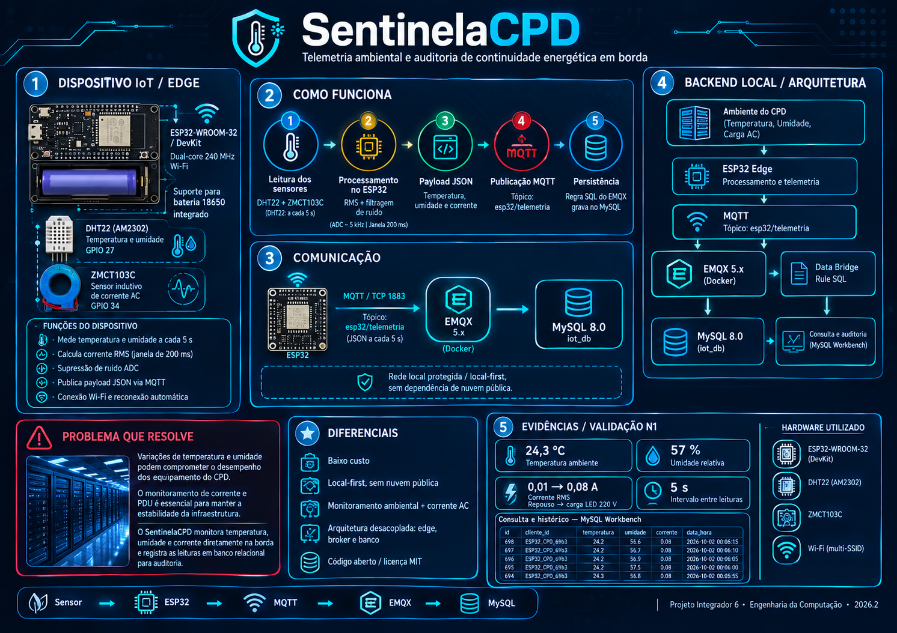


**🔗 GitPage:** [mikezinz.github.io/SentinelaCPD](https://mikezinz.github.io/SentinelaCPD/)  
**📦 Repositório:** [github.com/MikezinZ/SentinelaCPD](https://github.com/MikezinZ/SentinelaCPD)
**Dashboard web:** [demonstração pública](https://sentinela-cpd.arisenalto1.chatgpt.site) · [código e instruções](web/README.md)  
**Aplicativo mobile (Expo / iOS & Android):** [código e instruções](mobile/README.md)

---

## 📌 Status do Projeto: plataforma IoT completa (entrega final do 6º período)

O SentinelaCPD concluiu sua **primeira etapa de validação física e arquitetural (N1)** no Projeto Integrador 6 (Engenharia da Computação, 2026.2).

Nesta etapa, a plataforma coleta temperatura e umidade e calcula a corrente alternada eficaz ($I_{\text{RMS}}$) em um circuito de 220 V AC. Os dados seguem de um nó ESP32 até um broker MQTT (EMQX) em Docker e são gravados em um banco MySQL, onde podem ser consultados para auditoria.

A N1 é uma **validação de bancada** do conceito e **uma parte do projeto**. A instalação em um CPD real, a calibração com instrumento de referência, a alimentação por bateria e o TLS estão previstos para etapas posteriores (ver [limitações](#limitações-conhecidas) e [roadmap](#roadmap-rumo-à-n2)).

Na etapa N2, a camada de **Cloud** já tem implementados o serviço de ingestão, o modelo de incidentes de energia, a **API REST** para o aplicativo móvel e os **alertas por Telegram**. Veja a seção [Cloud: ingestão, API e alertas (N2)](#cloud-ingestão-api-e-alertas-n2).

Na entrega final, a plataforma passou a cobrir todos os requisitos técnicos mínimos (RF01 a RF10): **atualização remota de firmware pela dashboard (OTA, modalidade A)**, **gestão de usuários e dispositivos** no dashboard web e **broker MQTT com usuário, senha e ACL por tópico**. O mapa requisito → implementação → evidência está em [Entrega final: requisitos da plataforma IoT](#entrega-final-requisitos-da-plataforma-iot).

---

## 📑 Sumário

1. [Por que o SentinelaCPD?](#por-que-o-sentinelacpd)
2. [Motivação de engenharia](#motivação-de-engenharia)
3. [Objetivos e critérios de validação da N1](#objetivos-e-critérios-de-validação-da-n1)
4. [Stack tecnológica](#stack-tecnológica)
5. [Visão do sistema e arquitetura](#visão-do-sistema-e-arquitetura)
6. [Fundamentação matemática: RMS](#fundamentação-matemática-cálculo-discreto-de-rms)
7. [Hardware e pinagem](#hardware-e-pinagem)
8. [Esquemático e circuito eletrônico](#esquemático-e-circuito-eletrônico)
9. [Resultados experimentais (N1)](#resultados-experimentais-n1)
10. [Cloud: ingestão, API e alertas (N2)](#cloud-ingestão-api-e-alertas-n2)
11. [Entrega final: requisitos da plataforma IoT](#entrega-final-requisitos-da-plataforma-iot)
12. [Limitações conhecidas](#limitações-conhecidas)
13. [Princípios de engenharia](#princípios-de-engenharia-adotados)
14. [Organização do repositório](#organização-do-repositório)
15. [Como reproduzir](#como-reproduzir-o-projeto)
16. [Roadmap](#roadmap-rumo-à-n2)
17. [Licença](#licença-e-agradecimentos)

---

## Por que o SentinelaCPD?

Servidores e equipamentos de rede raramente avisam quando vão falhar.

Tradicionalmente, a infraestrutura física de TI opera em silos: o ar-condicionado tem seu termostato, os nobreaks (UPS) têm interfaces proprietárias e os técnicos só olham as telas depois do incidente (*downtime*).

Quando a climatização falha de madrugada ou uma tomada de distribuição (PDU) sofre sobrecorrente, a inércia térmica de um rack é curta. Em poucos minutos pode ocorrer *thermal throttling*, degradação de componentes ou desligamento abrupto de servidores.

O SentinelaCPD parte de uma pergunta:

> **Como transformar o ambiente do CPD em um sistema sensorial capaz de auditar continuamente variáveis térmicas e a presença/consumo de energia diretamente na borda?**

A resposta proposta é uma arquitetura de baixo custo, orientada a eventos e *local-first*, em vez de soluções industriais fechadas e caras.

---

## Motivação de engenharia

Ambientes de missão crítica seguem referências como as da **ASHRAE (TC 9.9)**, que recomenda temperatura de bulbo seco entre $18^\circ\text{C}$ e $27^\circ\text{C}$ para CPDs. Para umidade, as edições atuais usam ponto de orvalho; neste projeto adotamos $40\%$ a $60\%$ de umidade relativa como faixa prática de referência.

Três pilares sustentam o trabalho:

1. **Prevenção de hotspots térmicos:** mapear o microclima próximo aos racks antes que o calor residual atinja níveis destrutivos.
2. **Auditoria de carga e continuidade elétrica:** detectar a presença ou o corte de alimentação em circuitos-chave com sensoriamento indutivo não invasivo.
3. **Soberania e desacoplamento:** manter o pipeline de telemetria funcionando em rede local restrita, sem depender de nuvens públicas.

---

## Objetivos e critérios de validação da N1

A primeira versão do SentinelaCPD tem como objetivos:

1. Adquirir temperatura e umidade do ambiente.
2. Adquirir a corrente alternada por sensoriamento indutivo.
3. Calcular a corrente RMS no dispositivo de borda.
4. Transmitir as leituras por MQTT.
5. Receber e processar as mensagens no EMQX.
6. Persistir as informações em um banco MySQL.
7. Permitir a consulta e a auditoria das leituras armazenadas.
8. Validar fisicamente o funcionamento do pipeline completo.
9. Documentar a arquitetura, o circuito, o firmware e o processo de reprodução.

| Requisito | Implementação | Situação |
| --- | --- | :---: |
| Aquisição de temperatura e umidade | DHT22 | ✅ |
| Medição de corrente AC | ZMCT103C | ✅ |
| Cálculo de corrente RMS | ESP32 | ✅ |
| Comunicação sem fio | Wi-Fi | ✅ |
| Mensageria | MQTT 3.1.1 | ✅ |
| Broker e autenticação MQTT | EMQX 5.x | ✅ |
| Infraestrutura | Docker / Docker Compose | ✅ |
| Ingestão no banco | Data Bridge / regra SQL | ✅ |
| Persistência | MySQL 8.0 | ✅ |
| Validação dos dados | MySQL Workbench | ✅ |
| Teste físico | Cargas LED em 220 V AC | ✅ |
| API REST para o aplicativo | FastAPI (ver [Cloud](#cloud-ingestão-api-e-alertas-n2)) | ✅ N2 |
| Alertas por Telegram | Serviço `notifier` (ver [Cloud](#cloud-ingestão-api-e-alertas-n2)) | ✅ N2 |
| Dashboard em tempo real | — | 🔄 N2 |
| TLS/MQTTS | — | 🔄 N2 |

---

## Stack tecnológica

| Camada | Tecnologia | Papel no projeto |
| --- | --- | --- |
| **Hardware** | ESP32-WROOM-32 (placa com suporte 18650), DHT22 (AM2302), ZMCT103C | Microcontrolador dual-core com Wi-Fi e sensores de temperatura, umidade e corrente AC |
| **Firmware** | C++ (Arduino Core, que roda sobre FreeRTOS) | Amostragem, cálculo de RMS, formatação do payload e conexão de rede |
| **Bibliotecas** | `WiFi` / `WiFiMulti`, `PubSubClient`, `DHT` (`DHT.h`) | Conexão Wi-Fi multi-SSID, cliente MQTT e leitura do DHT22 |
| **Formato de dados** | JSON | Payload leve com temperatura, umidade e corrente |
| **Mensageria** | MQTT 3.1.1 sobre TCP (porta 1883), EMQX 5.x | Broker local, autenticação de dispositivo e regras SQL |
| **Persistência** | MySQL 8.0 | Armazenamento relacional de séries temporais |
| **Cloud (N2)** | Python 3 (`paho-mqtt`, `mysql-connector-python`), FastAPI + Uvicorn | Serviço de ingestão, modelo de incidentes, API REST e notificações |
| **Alertas (N2)** | Telegram Bot API | Avisos de queda de energia, temperatura e dispositivo offline |
| **Infraestrutura** | Docker e Docker Compose | Sobe EMQX, MySQL, ingestão, API e alertas de forma reproduzível |
| **Ferramentas** | MySQL Workbench, Arduino IDE | Consulta e auditoria dos dados; gravação do firmware |
| **Apresentação** | HTML, CSS e JavaScript (GitHub Pages) | Documentação pública do projeto |
| **Versionamento** | Git e GitHub | Controle de código; segredos fora do repositório |

---

## Visão do sistema e arquitetura

O SentinelaCPD é um **pipeline de dados contínuo**, projetado para:

* Amostrar periodicamente temperatura e umidade do ar;
* Calcular o valor eficaz (RMS) da corrente AC em janelas de 200 ms;
* Descartar o ruído do ADC quando não há carga;
* Montar payloads JSON leves;
* Reconectar sozinho ao Wi-Fi e ao broker;
* Persistir as leituras em banco relacional para auditoria.

### Diagrama completo do sistema

Todo o fluxo opera na rede local do CPD, sem dependência de serviços em nuvem. Percepção, roteamento de mensagens e armazenamento ficam desacoplados.

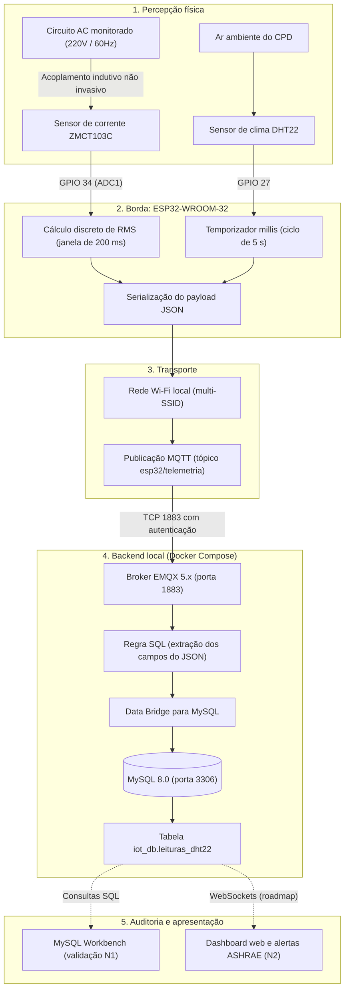

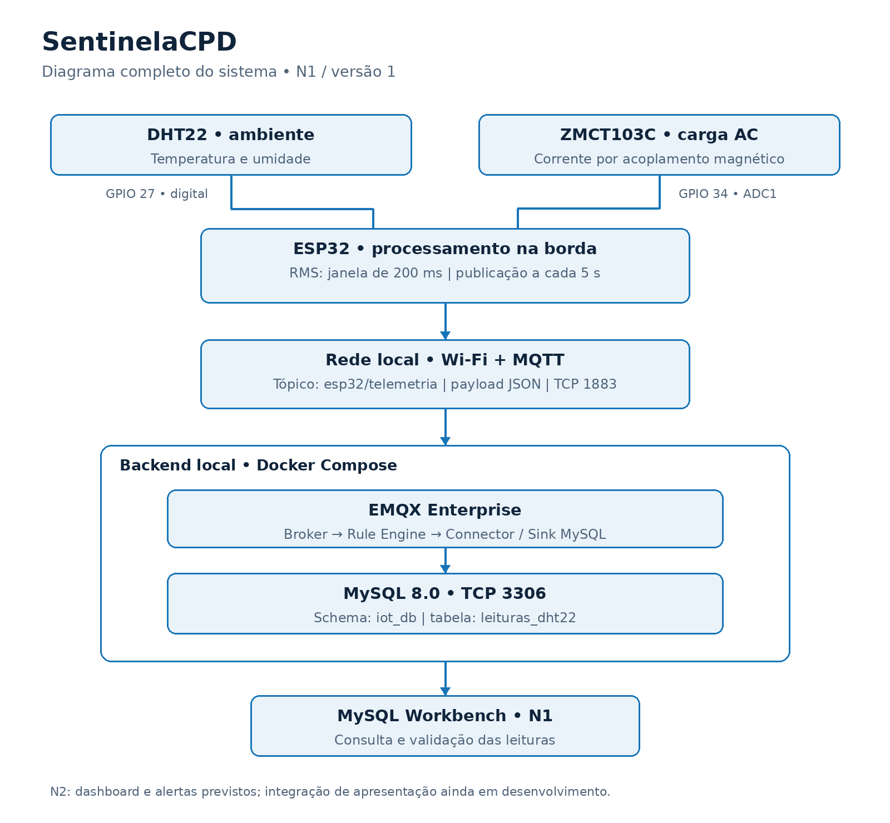

O ESP32 publica a cada 5 segundos um payload JSON como este:

```json
{"temperatura": 24.3, "umidade": 57.1, "corrente": 0.08}
```

### Camadas e responsabilidades

```text
+-------------------------------------------------------------------+
|                     Camada de Percepção (Sensing)                 |
|     [ DHT22: Temp/Umidade ]       [ ZMCT103C: Corrente AC ]       |
+---------------------------------+---------------------------------+
                                  │
                                  ▼
+-------------------------------------------------------------------+
|                   Camada de Borda (Edge Processing)               |
|                  ESP32 dual-core @ 240 MHz                        |
|   - Janela de 200 ms (~12 ciclos de 60 Hz) - Cálculo RMS          |
|   - Supressão de ruído do ADC              - Wi-Fi multi-SSID     |
+---------------------------------+---------------------------------+
                                  │ MQTT · TCP 1883
                                  ▼
+-------------------------------------------------------------------+
|               Camada de Mensageria e Ingestão (Docker)            |
|                            EMQX 5.x                               |
|   - Autenticação de dispositivo     - Parse JSON via regra SQL    |
+---------------------------------+---------------------------------+
                                  │ Data Bridge
                                  ▼
+-------------------------------------------------------------------+
|                  Camada de Persistência e Auditoria               |
|                         MySQL Database 8.0                        |
|   - Série temporal (leituras_dht22)                               |
|   - Consulta e validação via MySQL Workbench                      |
+-------------------------------------------------------------------+
```

### Responsabilidades por camada

| Camada | Componentes | Protocolo / barramento | Responsabilidade |
| --- | --- | --- | --- |
| **1. Percepção** | DHT22, ZMCT103C | Indução magnética / digital de 1 fio | Sensoriamento não invasivo de corrente e do microclima. |
| **2. Borda** | ESP32-WROOM-32 | GPIO 27, GPIO 34 (ADC1) | Aquisição, cálculo do $I_{\text{RMS}}$ e montagem do payload JSON. |
| **3. Transporte** | Wi-Fi 802.11 b/g/n | MQTT 3.1.1 sobre TCP (1883) | Publicação periódica com reconexão automática. |
| **4a. Mensageria** | EMQX 5.x (Docker) | MQTT e regra SQL | Autenticação de dispositivo, roteamento e ingestão no banco via Data Bridge. |
| **4b. Persistência** | MySQL 8.0 (Docker) | TCP 3306 / SQL | Armazenamento relacional da série temporal. |
| **5. Auditoria** | MySQL Workbench (N1), dashboard web (N2) | SQL / WebSockets | Validação dos dados na N1; visualização e alertas na N2. |

---

## Fundamentação matemática: cálculo discreto de RMS

O **ZMCT103C** é um transformador de corrente em miniatura. Como a corrente alternada é senoidal a $60\text{ Hz}$ ($T \approx 16{,}7\text{ ms}$), a média aritmética do sinal é próxima de zero e não serve como medida. O firmware calcula o valor eficaz em uma janela de $200\text{ ms}$ (cerca de 12 ciclos completos):

$$I_{\text{RMS}} = \sqrt{\frac{1}{N} \sum_{i=1}^{N} (x_i - \mu)^2} \cdot K$$

Em que:

* $N$: número de amostras na janela de $200\text{ ms}$ (taxa aproximada de $4$ a $5\text{ kHz}$, limitada pelo tempo de cada leitura do ADC);
* $x_i$: leitura bruta do ADC de 12 bits ($0$ a $4095$);
* $\mu$: média das amostras da própria janela, que remove o *offset* DC de polarização (observado em torno de 1680);
* $K$: constante de calibração que converte o valor do ADC em ampères. Ela depende da relação do transformador, do resistor de carga e do ganho do condicionamento de sinal, e é ajustada empiricamente.

### Supressão de piso de ruído

Com carga em repouso, o ADC do ESP32 ainda apresenta flutuações (ruído de quantização e de alimentação). Para evitar leituras espúrias, aplica-se um limiar sobre o desvio-padrão das amostras:

$$\text{Se } \sigma_{\text{ADC}} < 18{,}0 \implies I_{\text{RMS}} = 0{,}00\text{ A}$$

Com $K = 0{,}00055$ (valor de exemplo em `config.example.h`), esse limiar equivale a cerca de $0{,}0099\text{ A}$. Quando o ruído oscila logo acima dele, o sistema registra um piso residual de ~`0.01 A`, que é **ruído do ADC e não corrente real**.

---

## Hardware e pinagem

| Módulo | Interface elétrica | Pino ESP32 | Observações |
| --- | --- | --- | --- |
| **ESP32-WROOM-32** (placa com suporte 18650) | MCU / Wi-Fi | Micro-USB | Na N1, alimentação e gravação via USB. O suporte 18650 e o circuito de carga da placa **não são usados** nesta etapa. |
| **DHT22 (AM2302)** | Digital, 1 fio | **GPIO 27** | O módulo de 3 pinos já inclui o resistor de pull-up. No sensor de 4 pinos, use pull-up externo de 4,7 a 10 kΩ. Leitura a cada 5 s. Prefira alimentar em 3,3 V, para que o nível do pino de dados não ultrapasse 3,3 V no ESP32. |
| **ZMCT103C** | Analógico com offset DC | **GPIO 34 (ADC1)** | ADC1 evita conflito com o rádio Wi-Fi. A saída do módulo **não pode passar de 3,3 V** no pino do ESP32. Confira com multímetro a tensão no ponto médio da saída. |
| **Barramento de alimentação** | DC | 3V3 / 5V / GND | Trilhas dedicadas da protoboard. |
| **Circuito AC (220 V)** | Acoplamento magnético | Isolado | Apenas o condutor **fase** atravessa o toroide. O sensor não faz contato elétrico com o circuito. |

> ⚠️ **Segurança:** o teste envolve tensão de rede (220 V AC). Mantenha emendas e conexões do cabo de carga isoladas e afastadas da protoboard e do notebook. Nunca manipule o circuito energizado.

---

## Esquemático e circuito eletrônico

O sistema separa a eletrônica de borda (DC, baixa tensão) da linha de potência monitorada (220 V AC / 60 Hz). O isolamento galvânico é dado pelo próprio transformador de corrente do ZMCT103C: o condutor fase atravessa o toroide e o sinal chega ao ESP32 apenas por acoplamento magnético. As ligações entre o microcontrolador e os sensores usam os barramentos de alimentação e as linhas 17 e 27 da protoboard.

> Na N1, a carga monitorada foi uma lâmpada/painel LED (ver [Resultados experimentais](#resultados-experimentais-n1)). Na aplicação-alvo, o mesmo condutor seria o circuito de alimentação de um rack ou PDU.

### Mapeamento físico da protoboard

```text
===================== BARRAMENTO SUPERIOR (+) =====================
 [Barramento (+)] ────┬──────────────────┬──────────────────┐
                      │                  │                  │
                      ▼                  ▼                  ▼
                 [ESP32 VIN]        [DHT22 VCC]      [ZMCT103C VCC]

===================== BARRAMENTO INFERIOR (-) =====================
 [Barramento (-)] ────┬──────────────────┬──────────────────┐
                      │                  │                  │
                      ▼                  ▼                  ▼
                 [ESP32 GND]        [DHT22 GND]      [ZMCT103C GND]

========================== NÓS DE SINAL ===========================

 Linha 17 (barramento de dados do DHT22):
 [ESP32 GPIO 27] ──► Furo 17f ═══ (trilha interna 17) ═══ Furo 17j ◄── [DHT22 DAT]

 Linha 27 (canal analógico ADC1 do ZMCT103C):
 [ESP32 GPIO 34] ──► Furo 27f ═══ (trilha interna 27) ═══ Furo 27j ◄── [ZMCT103C OUT]

========================= ISOLAMENTO GALVÂNICO ====================

 Condutor fase (220 V) ──► ( Furo toroidal do ZMCT103C ) ──► Carga monitorada
                               [Acoplamento indutivo]
```

### Esquemático estrutural do sistema

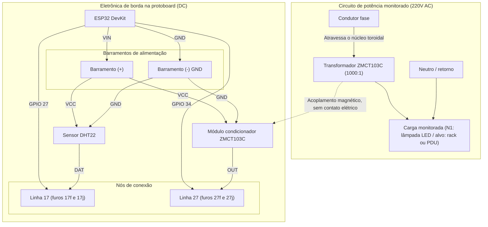

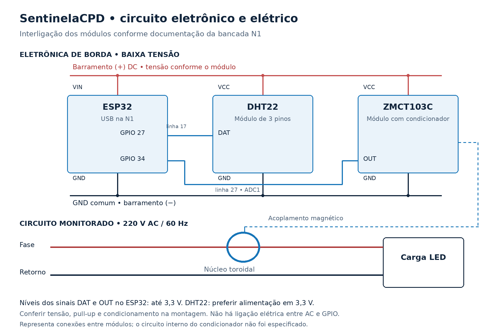

A imagem representa as conexões documentadas entre os módulos; não especifica o circuito interno do condicionador. Confira alimentação e níveis de sinal conforme a seção de pinagem.

### Matriz de conexões e roteamento físico

| Dispositivo | Terminal | Ponto na protoboard | Destino | Domínio / interface | Função técnica |
| --- | --- | --- | --- | --- | --- |
| **ESP32** | `VIN` | Barramento (`+`) | Trilhas de alimentação | 5 V DC (da USB) | Fornece a tensão de 5 V ao barramento (+), alimentado via USB na N1. |
| **ESP32** | `GND` | Barramento (`-`) | Barramento de retorno | 0 V DC | Terra comum e referência de sinal. |
| **ESP32** | `GPIO 27` | Furo `17f` | Linha 17 (furo `17j`) | Digital, 1 fio | Linha de dados do sensor térmico. |
| **DHT22** | `DAT` | Furo `17j` | Linha 17 (furo `17f`) | Digital, 1 fio | Envio dos dados de temperatura e umidade. |
| **DHT22** | `VCC` | Barramento (`+`) | Trilhas de alimentação | Tensão do barramento (+) | Alimentação do sensor climático. |
| **DHT22** | `GND` | Barramento (`-`) | Barramento de retorno | 0 V DC | Terra do sensor. |
| **ESP32** | `GPIO 34` | Furo `27f` | Linha 27 (furo `27j`) | Analógico (ADC1) | Aquisição contínua para o cálculo do $I_{\text{RMS}}$. |
| **ZMCT103C** | `OUT` | Furo `27j` | Linha 27 (furo `27f`) | Analógico (sinal AC com offset) | Tensão senoidal proporcional à corrente, centrada no ponto médio de polarização. |
| **ZMCT103C** | `VCC` | Barramento (`+`) | Trilhas de alimentação | Tensão do barramento (+) | Alimentação do condicionador de sinal do módulo. |
| **ZMCT103C** | `GND` | Barramento (`-`) | Barramento de retorno | 0 V DC | Referência do circuito de condicionamento. |
| **Linha AC** | Condutor fase | Furo toroidal | Carga monitorada | 220 V AC / 60 Hz | Leitura por indução eletromagnética, sem contato elétrico. |

> **Observação:** a tensão do barramento (+) deve respeitar os limites de nível lógico descritos em [Hardware e pinagem](#hardware-e-pinagem): DHT22 preferencialmente em 3,3 V e saída do ZMCT103C sempre abaixo de 3,3 V no pino do ESP32.
> As linhas 17 e 27 ligam o pino do ESP32 ao sensor na mesma tira de contatos (furos `f` a `j`), sem jumpers adicionais.

---

## Resultados experimentais (N1)

Foram feitos dois testes de bancada com cargas LED de 220 V AC passando pelo sensor de corrente. Os registros foram gravados no MySQL pela regra do EMQX.

### Teste 1: painel LED de 18 W (27/09/2026)

```sql
SELECT id, cliente_id, temperatura, umidade, corrente, data_hora
FROM iot_db.leituras_dht22
ORDER BY id;
-- trecho dos registros; ids 444 a 447 omitidos por brevidade
```

```text
+-----+----------------+-------------+---------+----------+---------------------+
| id  | cliente_id     | temperatura | umidade | corrente | data_hora           |
+-----+----------------+-------------+---------+----------+---------------------+
| 440 | ESP32_CPD_8544 | 30.9        | 67.6    | 0.00     | 2026-09-27 15:46:37 |
| 441 | ESP32_CPD_8544 | 30.9        | 67.6    | 0.13     | 2026-09-27 15:46:42 |
| 442 | ESP32_CPD_8544 | 31.0        | 67.4    | 0.12     | 2026-09-27 15:46:47 |
| 443 | ESP32_CPD_8544 | 31.0        | 67.0    | 0.13     | 2026-09-27 15:46:52 |
| 448 | ESP32_CPD_8544 | 31.0        | 66.9    | 0.00     | 2026-09-27 15:47:17 |
+-----+----------------+-------------+---------+----------+---------------------+
```

* **Sem carga:** leitura de `0.00 A`.
* **Carga ligada:** leitura estável em torno de `0.13 A`.

### Teste 2: lâmpada LED de bulbo (02/10/2026)

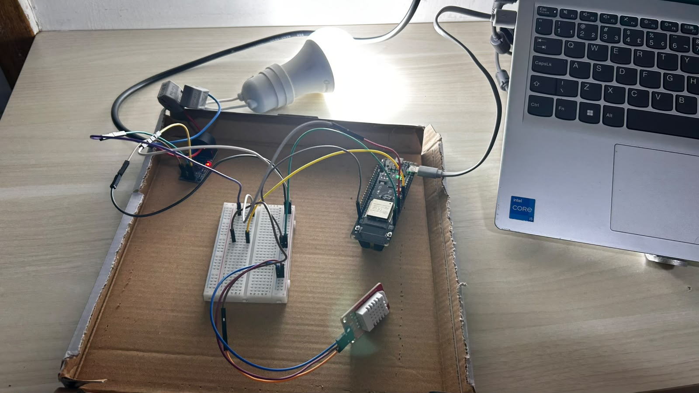

*Montagem de bancada: o condutor fase atravessa o toroide do ZMCT103C, sem contato elétrico com o circuito lógico.*

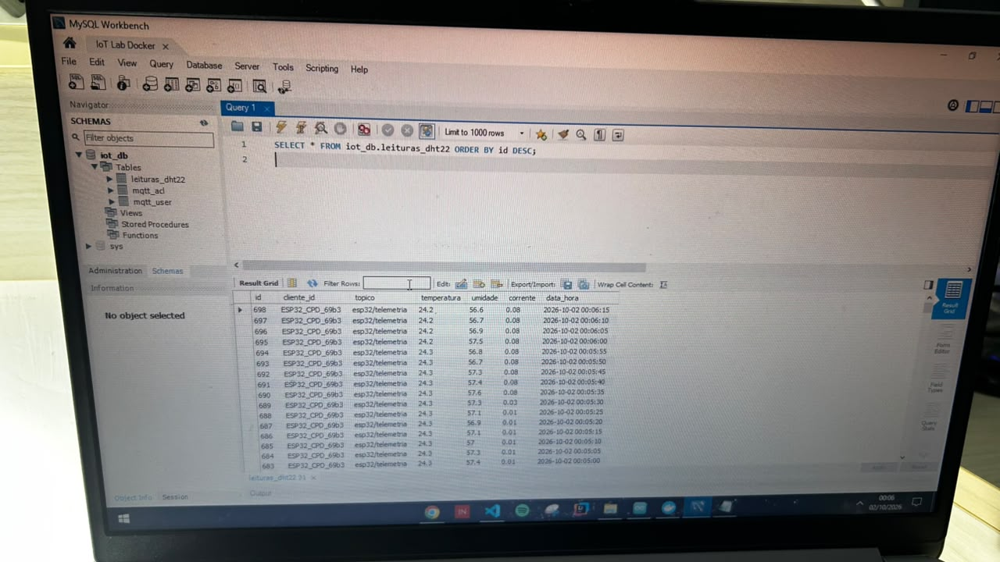

*Registros no banco `iot_db` mostrando a transição de estado da corrente, gravados pelo Data Bridge.*

```text
+-----+----------------+-------------------+-------------+---------+----------+---------------------+
| id  | cliente_id     | topico            | temperatura | umidade | corrente | data_hora           |
+-----+----------------+-------------------+-------------+---------+----------+---------------------+
| 698 | ESP32_CPD_69b3 | esp32/telemetria  | 24.2        | 56.6    | 0.08     | 2026-10-02 00:06:15 |
| 697 | ESP32_CPD_69b3 | esp32/telemetria  | 24.2        | 56.7    | 0.08     | 2026-10-02 00:06:10 |
| 696 | ESP32_CPD_69b3 | esp32/telemetria  | 24.2        | 56.9    | 0.08     | 2026-10-02 00:06:05 |
| 695 | ESP32_CPD_69b3 | esp32/telemetria  | 24.2        | 57.5    | 0.08     | 2026-10-02 00:06:00 |
| 694 | ESP32_CPD_69b3 | esp32/telemetria  | 24.3        | 56.8    | 0.08     | 2026-10-02 00:05:55 |
| 693 | ESP32_CPD_69b3 | esp32/telemetria  | 24.3        | 56.7    | 0.08     | 2026-10-02 00:05:50 |
| 692 | ESP32_CPD_69b3 | esp32/telemetria  | 24.3        | 57.3    | 0.08     | 2026-10-02 00:05:45 |
| 691 | ESP32_CPD_69b3 | esp32/telemetria  | 24.3        | 57.4    | 0.08     | 2026-10-02 00:05:40 |
| 690 | ESP32_CPD_69b3 | esp32/telemetria  | 24.3        | 57.6    | 0.08     | 2026-10-02 00:05:35 |
| 689 | ESP32_CPD_69b3 | esp32/telemetria  | 24.3        | 57.3    | 0.03     | 2026-10-02 00:05:30 |
| 688 | ESP32_CPD_69b3 | esp32/telemetria  | 24.3        | 57.1    | 0.01     | 2026-10-02 00:05:25 |
| 687 | ESP32_CPD_69b3 | esp32/telemetria  | 24.3        | 56.9    | 0.01     | 2026-10-02 00:05:20 |
| 686 | ESP32_CPD_69b3 | esp32/telemetria  | 24.3        | 57.1    | 0.01     | 2026-10-02 00:05:15 |
| 685 | ESP32_CPD_69b3 | esp32/telemetria  | 24.3        | 57.0    | 0.01     | 2026-10-02 00:05:10 |
| 684 | ESP32_CPD_69b3 | esp32/telemetria  | 24.3        | 57.3    | 0.01     | 2026-10-02 00:05:05 |
| 683 | ESP32_CPD_69b3 | esp32/telemetria  | 24.3        | 57.4    | 0.01     | 2026-10-02 00:05:00 |
+-----+----------------+-------------------+-------------+---------+----------+---------------------+
```

* **Sem carga:** a corrente ficou em um piso residual de `0.01 A` (registros 683 a 688), que corresponde ao [piso de ruído do ADC](#supressão-de-piso-de-ruído).
* **Transição:** ao ligar a carga, a leitura passou por `0.03 A` (registro 689) e estabilizou em `0.08 A` a partir do registro 690.
* **Ambiente:** temperatura em torno de `24.3 °C` e umidade em torno de `57 %`, com leituras regulares a cada 5 s e sem perda de registros no trecho mostrado.

> Os dois testes usaram cargas diferentes, por isso os valores de corrente diferem. O `cliente_id` muda entre os testes porque o firmware gera um ID aleatório a cada conexão MQTT.

---

## Cloud: ingestão, API e alertas (N2)

A camada de Cloud transforma a telemetria bruta da N1 em **informação de operação**: estado do CPD, incidentes de energia com duração, API para o aplicativo móvel e alertas ativos. Ela roda inteira em Docker Compose, na rede local, e foi validada de ponta a ponta com um ESP32 real (DHT22 → Wi-Fi → EMQX → MySQL → API → Telegram).

> **Responsável:** Diogo Novaes. O código fica na raiz do repositório: `api/`, `ingestor/`, `notifier/`, `db/` e o `docker-compose.yml`.

### Arquitetura

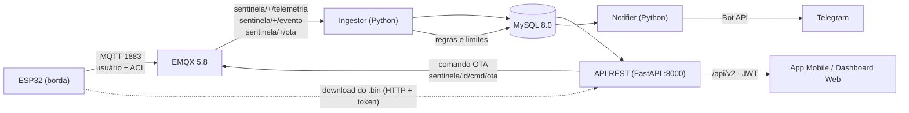

| Serviço | Imagem / tecnologia | Responsabilidade |
| --- | --- | --- |
| `emqx` | `emqx/emqx:5.8.0` | Broker MQTT (1883), dashboard (18083) e WebSocket (8083); usuário/senha e ACL por tópico (`emqx/acl.conf`) |
| `mysql` | `mysql:8.0` | Persistência; schema criado por `db/init.sql` |
| `ingestor` | Python + `paho-mqtt` | Assina os tópicos, valida faixas, grava leituras, abre/fecha incidentes e roda o motor de alertas |
| `api` | FastAPI + Uvicorn | API v2 do app e do dashboard (login, perfis, alertas, limites), administração (usuários, dispositivos, firmware/OTA) e rotas v1 simples |
| `notifier` | Python (`urllib`) | Consulta o banco a cada 5 s e envia alertas ao Telegram |

> Na N1 a gravação era feita por Data Bridge e regra SQL do EMQX. Na Cloud, a ingestão passou para um serviço próprio (`ingestor`), porque o Data Bridge não expressa a lógica de **incidentes** (abrir, fechar e calcular duração) nem valida os dados. O tópico legado `esp32/telemetria` continua aceito e é gravado como `ESP32_CPD_01`.

### Contrato de mensagens MQTT

| Tópico | Payload |
| --- | --- |
| `sentinela/<id>/telemetria` | `{"temperatura":27.8,"umidade":45.4,"corrente":0.8,"bateria":87,"rede":true,"firmware":"0.3.0"}` (campos opcionais; `rede` é a fonte externa lida pelo PC817 e `firmware` é gravado em `dispositivos.firmware`) |
| `sentinela/<id>/evento` | `{"evento":"POWER_LOSS","estado":"ON_BATTERY","temperatura":29.4,"umidade":58.2,"bateria":87}` |
| `sentinela/<id>/cmd/ota` | plataforma → ESP32: `{"job":7,"version":"0.4.1","sequence":5,"target":"esp32","size":1085488,"sha256":"…","url":"/api/v2/ota/jobs/7/firmware.bin?token=…"}` |
| `sentinela/<id>/ota` | ESP32 → plataforma: `{"job":7,"status":"downloading","detail":"…","version":"0.4.0"}` (status: `downloading`, `installed`, `success`, `failed`, `rejected`, `rolled_back`) |
| `esp32/telemetria` | legado da N1, sem id |

Eventos válidos: `POWER_LOSS`, `LAST_GASP` e `POWER_RESTORED`. `POWER_LOSS` e `LAST_GASP` abrem um incidente de queda de energia e colocam o dispositivo em `ON_BATTERY`; `POWER_RESTORED` fecha o incidente e calcula a duração.

### Modelo de dados

| Tabela | Conteúdo |
| --- | --- |
| `dispositivos` | id, nome, local, estado, energia (`mains`/`battery`/`unknown`), ativo, firmware, criado_em, ultimo_contato |
| `leituras` | dispositivo_id, temperatura, umidade, corrente, bateria, data_hora |
| `eventos` | dispositivo_id, tipo, payload (JSON), data_hora |
| `incidentes` | dispositivo_id, tipo (`QUEDA_ENERGIA`), status (`ABERTO`/`FECHADO`), inicio, fim, duracao_s |
| `alertas` | tipo, severidade, mensagem, aberto/reconhecido/resolvido, quem reconheceu e nota |
| `limites` | faixas de temperatura, umidade e corrente por dispositivo, histerese, amostras seguidas e versão |
| `usuarios` / `sessoes` | contas com perfil (`viewer`, `operator`, `admin`) e tokens de renovação |
| `notificacoes` | controle de alertas já enviados ao Telegram, para não repetir (chave única `tipo` + `referencia_id`) |
| `firmwares` | versões enviadas pela dashboard: versão, sequência, placa, tamanho, SHA-256, notas e quem enviou (o arquivo fica no volume `firmware_data`) |
| `ota_jobs` | cada atualização: dispositivo, versão de origem e destino, status, detalhe, hash do token de download, quem iniciou e quando terminou |

As tabelas da API v2 são criadas automaticamente ao subir a API (`api/schema.py`), inclusive em bancos que já existiam.

### API v2 (app mobile e dashboard web)

Contrato usado pelo `mobile/` e pelo `web/`. Documentação interativa em `http://<host>:8000/docs`. Todas as rotas, exceto `/auth/*`, exigem `Authorization: Bearer <token>`. Erros seguem o formato `{"error": {"message", "fields"}, "request_id"}`.

| Rota | Perfil | O que faz |
| --- | --- | --- |
| `POST /api/v2/auth/login` · `/auth/refresh` · `/auth/logout` | — | Login (token de 15 min e renovação rotativa de 7 dias) |
| `GET /api/v2/me` | todos | Usuário logado |
| `GET /api/v2/devices` · `/devices/{id}` | todos | Dispositivos com última leitura, `freshness`, `power_state`, `battery_pct` e alertas ativos |
| `GET /api/v2/devices/{id}/readings?from&to&bucket` | todos | Histórico `raw`, `1m` ou `15m` com mín./máx./média por métrica |
| `GET /api/v2/devices/{id}/incidents` | todos | Quedas de energia com início, fim e duração |
| `GET /api/v2/alerts?state&device_id` | todos | Alertas `active`, `acknowledged` ou `resolved` |
| `POST /api/v2/alerts/{id}/ack` | operator, admin | Reconhece o alerta com nota |
| `GET` · `PUT /api/v2/devices/{id}/limits` | admin | Limites com controle de versão (HTTP 409 se outra sessão salvou antes) |
| `GET` · `POST /api/v2/users` · `PUT /api/v2/users/{id}` | admin | Lista, cadastra, muda perfil/nome, desativa e redefine senha (encerra as sessões do usuário). Não deixa a plataforma sem admin ativo |
| `POST /api/v2/me/password` | todos | Troca a própria senha (exige a atual) |
| `POST /api/v2/devices` · `PUT /api/v2/devices/{id}` | admin | Vincula um dispositivo pelo ID, renomeia, informa o local e ativa/desativa (dados de desativado são descartados) |
| `GET` · `POST /api/v2/firmware` | todos / admin | Lista versões; envia um `.bin` (corpo `application/octet-stream`), validado e com SHA-256 calculado |
| `POST /api/v2/devices/{id}/ota` | admin | Inicia a atualização: cria o job e publica o comando MQTT |
| `GET /api/v2/ota/jobs?device_id` | todos | Histórico e andamento das atualizações |
| `GET /api/v2/ota/jobs/{id}/firmware.bin?token` | ESP32 | Download do firmware com token de uso único (15 min) |

**Alertas automáticos (ingestor):** `temperature_high/low`, `humidity_high/low` e `current_high` usam os limites do dispositivo com histerese e N amostras seguidas; `sensor_invalid` quando o DHT22 para de responder; `battery_low` abaixo de 20 %; `power_loss` entre `POWER_LOSS` e `POWER_RESTORED`; `telemetry_stale` após `STALE_ALERT_S` sem dados. Os limites padrão seguem a ASHRAE (18 a 27 °C) e a faixa de 40 a 60 % de umidade.

**Usuários:** com `DEMO_USERS=true`, a API cria `admin@`, `operator@` e `viewer@sentinelacpd.demo` (senha `Sentinela123`), os mesmos da demonstração dos apps. Para contas reais, defina `ADMIN_EMAIL`/`ADMIN_PASSWORD` ou rode:

```bash
docker compose exec api python criar_usuario.py --email ana@empresa.com --nome "Ana" --papel operator
```

Senhas são guardadas com PBKDF2-SHA256; os tokens são assinados com `JWT_SECRET`.

### API v1 (rotas simples)

Mantidas para compatibilidade e testes rápidos. Exigem o cabeçalho `X-API-Key` (quando `API_KEY` está definida) ou o mesmo token de login da v2; nenhuma rota de dados fica aberta sem autenticação. No Swagger, use o botão **Authorize**.

| Rota | O que devolve |
| --- | --- |
| `GET /health` | API e banco no ar (sem chave) |
| `GET /api/status-cpd` | situação geral e último valor de cada dispositivo |
| `GET /api/telemetria?dispositivo=&de=&ate=&limite=` | histórico, mais recente primeiro (máx. 1000) |
| `GET /api/incidentes?dispositivo=&status=&limite=` · `/api/incidentes/{id}` | incidentes com duração e eventos |
| `GET /api/dispositivos` | dispositivos cadastrados |

### Alertas por Telegram

| Situação | Aviso |
| --- | --- |
| Incidente de energia aberto | 🔴 queda de energia detectada |
| Incidente fechado | 🟢 energia restabelecida, com a duração |
| Temperatura acima de `TEMP_LIMITE` | 🌡️ alerta; avisa também quando normaliza (histerese de 1 °C) |
| Dispositivo sem dados por `OFFLINE_S` | ⚠️ dispositivo offline; avisa quando volta |

Detalhes de projeto: um alerta de offline só é emitido para dispositivo que já esteve online, a tabela `notificacoes` evita duplicidade, incidentes anteriores à primeira execução não geram avisos antigos e o token nunca é escrito no log. Sem token, o serviço roda em modo teste e apenas registra as mensagens.

### Como subir

```bash
cp .env.example .env        # defina senhas, JWT_SECRET, TELEGRAM_TOKEN e TELEGRAM_CHAT_ID
docker compose up -d --build
docker compose logs -f ingestor
```

Variáveis (`.env.example`): `MYSQL_*`, `MQTT_PLATFORM_PASS` e `MQTT_DEVICE_PASS` (obrigatórias), `EMQX_DASHBOARD_PASS`, `OTA_BASE_URL`, `JWT_SECRET`, `DEMO_USERS`, `ADMIN_EMAIL`, `ADMIN_PASSWORD`, `STALE_AFTER_S` (15), `STALE_ALERT_S` (60), `CORS_ORIGINS`, `API_KEY`, `TEMP_LIMITE` (35), `ONLINE_TIMEOUT_S` (30), `OFFLINE_S` (60), `TELEGRAM_TOKEN`, `TELEGRAM_CHAT_ID`.

> 🔒 O arquivo `.env` contém senhas e o token do bot. Ele está no `.gitignore` e **nunca** deve ser publicado. Se o token vazar, gere outro com `/revoke` no `@BotFather`.

Teste sem o ESP32 (o broker exige senha; com o usuário `dispositivo`, o client id `-i` precisa ser o ID usado no tópico):

```bash
mosquitto_pub -h localhost -u dispositivo -P "$MQTT_DEVICE_PASS" -i ESP32_CPD_01 -t sentinela/ESP32_CPD_01/telemetria -m '{"temperatura":27.8,"umidade":45.4}'
mosquitto_pub -h localhost -u dispositivo -P "$MQTT_DEVICE_PASS" -i ESP32_CPD_01 -t sentinela/ESP32_CPD_01/evento -m '{"evento":"POWER_LOSS"}'
mosquitto_pub -h localhost -u dispositivo -P "$MQTT_DEVICE_PASS" -i ESP32_CPD_01 -t sentinela/ESP32_CPD_01/evento -m '{"evento":"POWER_RESTORED"}'
```

No WebSocket Client do dashboard do EMQX (`localhost:18083` › Diagnose), conecte com o usuário `plataforma` para simular eventos de qualquer dispositivo.

Teste automatizado da plataforma (usuários, dispositivos, firmware e OTA com um ESP32 simulado), com tudo no ar:

```bash
pip install paho-mqtt
MQTT_DEVICE_USER=dispositivo MQTT_DEVICE_PASS=... python tests/plataforma/teste_plataforma.py caminho/firmware.ino.bin
```

### O que foi validado

* ✅ ESP32 real publicando temperatura e umidade a cada 5 s até o banco e a API.
* ✅ Abertura e fechamento de incidente (via evento MQTT) com cálculo de duração e alertas no Telegram.
* ✅ Alerta de dispositivo offline e de retorno.
* ✅ API consultada pelo Swagger e pelo navegador.
* ✅ API v2 testada contra o contrato dos apps: 42 verificações automatizadas (login, perfis, dispositivos, histórico, alertas, reconhecimento, limites com conflito de versão, incidentes, CORS) e o próprio cliente do app mobile rodando contra a API real.
* ✅ Motor de alertas testado com abertura e resolução por histerese, amostras seguidas, queda de energia, bateria baixa, sensor inválido e silêncio.
* ✅ Alerta de temperatura e umidade ao vivo com o DHT22, reconhecimento com nota e resolução automática (apresentação de 17/11/2026).
* ✅ Plataforma da entrega final: 32 verificações automatizadas (`tests/plataforma/teste_plataforma.py`) cobrindo cadastro e perfis de usuários, vínculo e desativação de dispositivos, validação do `.bin`, OTA completa com ESP32 simulado e recusa de tokens inválidos, rodando contra o EMQX 5.8.0 com autenticação e ACL.
* ✅ ACL do broker testada no EMQX 5.8.0: conexão anônima e senha errada recusadas, uma placa não publica nem assina tópicos de outra, só a plataforma envia comandos.
* ✅ Firmware 0.4.0 compilado com o núcleo ESP32 3.3.12 (1,08 MB, slot OTA de 1,875 MB, rollback habilitado no bootloader) e testes do comando OTA (`tests/firmware/remote_ota_test.cpp`).
* ⏳ Os eventos de queda de energia foram **simulados** por publicação MQTT, sem corte real de energia. O firmware já publica `bateria`, `rede` e os eventos, mas depende da ligação do PC817 e do divisor da bateria (`POWER_PRESENT_PIN` e `BATTERY_ADC_PIN`).

### Decisões de arquitetura e próximos passos

Itens abaixo são **propostas**, exceto onde indicado.

| Tema | Decisão |
| --- | --- |
| Banco de dados | Manter MySQL no volume atual; migrar para TimescaleDB se o volume de séries temporais crescer. MongoDB descartado: o modelo é relacional (dispositivo, leitura, incidente). |
| Redis | Cache do último estado por dispositivo, rate limit e pub/sub para empurrar eventos ao app. |
| OTA | **Implementado:** OTA remota pela dashboard (modalidade A), ver [Entrega final](#atualização-de-firmware-ota-remota-pela-dashboard). O OTA por manifesto assinado com RSA (`SecureOta.h`) continua disponível para quando houver servidor HTTPS de releases. |
| Segurança | **Implementado:** usuário/senha e ACL por tópico no EMQX; login com JWT e perfis. Próximo: TLS (8883) e HTTPS na frente da API; backup e retenção de dados. |
| IA | Abordagem híbrida: regras e z-score para anomalias simples, Isolation Forest para padrões multivariados. |
| Tempo real | WebSocket ou push para o aplicativo, em substituição ao polling. |

## Entrega final: requisitos da plataforma IoT

Esta seção responde ao documento *Requisitos técnicos mínimos da plataforma IoT (6º período)*. A arquitetura segue a referência pedida: **dispositivo ↔ broker MQTT ↔ serviço de ingestão ↔ banco de dados**, com a **dashboard ↔ API**. O ESP32 nunca acessa o banco: ele só fala com o broker e, durante uma atualização, baixa o arquivo da API com um token.

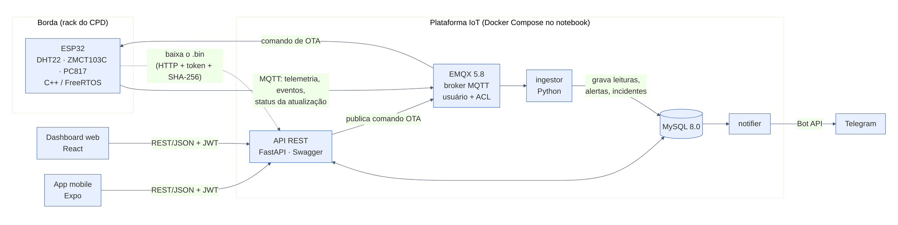

Versão editável do diagrama:

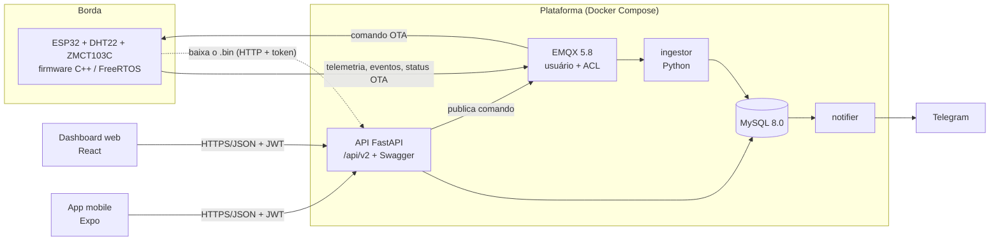

### Mapa dos requisitos

| ID | Requisito | Onde está | Evidência |
| --- | --- | --- | --- |
| RF01 | Comunicação MQTT | EMQX 5.8; tópicos `sentinela/<id>/telemetria`, `/evento`, `/ota` e `/cmd/ota` | ESP32 real publicando a cada 5 s; comando de OTA recebido pela placa |
| RF02 | Persistência | MySQL 8.0 em volume Docker (`mysql_data`); firmwares no volume `firmware_data` | Dados e versões continuam após `docker compose down` / `up` |
| RF03 | Dashboard | `web/` (React): visão geral, detalhe, histórico, alertas, limites, **Administração** e **Firmware (OTA)** | Telas abaixo e demonstração ao vivo |
| RF04 | Usuários | Login JWT, perfis viewer/operator/admin; cadastro, edição de perfil, desativação e redefinição de senha na tela Administração | `tests/plataforma`: 11 verificações de usuários |
| RF05 | Dispositivos | ID fixo por placa (`ESP32_CPD_<MAC>`); vincular, renomear, informar local e desativar pela dashboard | Dados de dispositivo desativado são descartados (teste automatizado) |
| RF06 | Monitoramento | Última leitura, atualidade, energia, bateria, alertas, incidentes e histórico raw/1 min/15 min | App e web com dados reais |
| RF07 | APIs | REST documentada no Swagger (`/docs`, com botão Authorize): dados, histórico, dispositivos, usuários, estados, firmware | Swagger com exemplos de corpo |
| RF08 | Firmware | **Modalidade A: OTA remota pela dashboard**, com SHA-256, versão, compatibilidade e rollback | Atualização real 0.4.0 → 0.4.1 na demonstração |
| RF09 | Segurança | Broker com usuário/senha e ACL por tópico; senhas PBKDF2; JWT de 15 min; ações sensíveis só para admin; nenhuma rota de dados sem login (inclusive a v1); segredos em `.env`/`config.h` fora do Git; token de download de uso único | Teste da ACL no EMQX e 403 para perfis sem permissão |
| RF10 | Documentação | Este README, `web/README.md`, `mobile/README.md`, `firmware/README.md`, GitPage com "Tecnologias utilizadas" | — |
| RNF01 | Segurança | Ver RF09 | — |
| RNF02 | Confiabilidade | Firmware reconecta Wi-Fi/MQTT com backoff sem parar a coleta; ingestor e API reconectam sozinhos; alerta de dispositivo sem dados; OTA aborta sem apagar a versão atual | Teste de tirar o USB: app "Desatualizado" + Telegram |
| RNF03 | Persistência | Volumes Docker; migração idempotente (`schema.py`) que não apaga dados | — |
| RNF04 | Manutenibilidade | Serviços separados por responsabilidade; regras do firmware em cabeçalhos testáveis no PC | Testes em `tests/` |
| RNF05 | Escalabilidade | Ver [Escalabilidade](#escalabilidade-para-mais-dispositivos) | — |
| RNF06 | Implantação | `docker compose up -d --build` + `.env.example` + `config.example.h` | [Como subir](#como-subir) |
| RNF07 | Usabilidade | Dashboard com perfis, mensagens de erro por campo e textos de ajuda | Telas abaixo |

### Atualização de firmware: OTA remota pela dashboard

Escolhemos a **modalidade A** porque ela permite gerenciar a frota pela plataforma, sem ir até o rack com um notebook. A modalidade B (upload local pelo IP da placa) exigiria abrir um servidor web autenticado permanente no ESP32, o que amplia a superfície de ataque, e não é gestão centralizada.

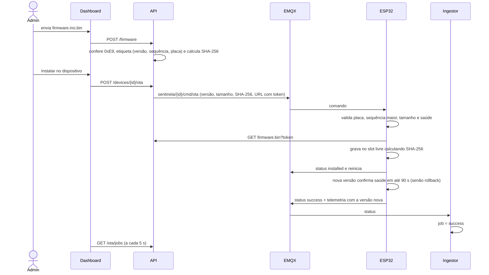

| Exigência do documento | Como foi atendida |
| --- | --- |
| Autenticação e autorização | Só o perfil admin envia firmware e inicia atualizações (API). Só o usuário `plataforma` do broker pode publicar em `cmd/ota` (ACL). O download exige token aleatório de uso único, válido por 15 min, guardado só como hash |
| Integridade | SHA-256 calculado na API e conferido pelo ESP32 enquanto grava; tamanho exato; validação da imagem pelo ESP-IDF (`esp_ota_end`) |
| Compatibilidade | Etiqueta `SENTINELA_FW\|v=…\|seq=…\|target=esp32\|` gravada no binário: a API recusa arquivo sem etiqueta ou de outra placa, e o ESP32 confere a placa de novo |
| Arquivos inválidos | API recusa arquivo que não começa com o byte mágico `0xE9`, maior que o slot ou com sequência repetida; ESP32 recusa download que não bate com o SHA-256 |
| Identificação das versões | Versão e sequência crescente; o ESP32 recusa versão igual ou anterior (anti-downgrade); a dashboard mostra versão atual e histórico "de → para" |
| Tratamento de falhas | Download interrompido, hash errado ou falta de energia externa abortam sem tocar na versão atual (dois slots OTA). Sem resposta em 10 min, o job vira `timeout` |
| Evidência do resultado | Cada etapa (`downloading`, `installed`, `success`, `failed`, `rejected`, `rolled_back`) fica registrada em `ota_jobs` com data, detalhe e quem iniciou |
| Rollback (diferencial) | Bootloader com rollback: a nova versão precisa provar que coleta dados em até 90 s; se travar, o ESP32 volta para a anterior e informa `rolled_back` |

Por que HTTP para o arquivo e MQTT só para o comando: o binário tem cerca de 1 MB, maior que o buffer do PubSubClient e do que se costuma trafegar por MQTT. O documento recomenda exatamente essa divisão.

**Como demonstrar uma atualização real**

1. Grave pelo USB o firmware 0.4.0 (primeira vez que a placa recebe o suporte a OTA; a tabela de partições com dois slots de 1,875 MB vai junto).
2. Em `firmware/ProductConfig.h`, mude para `FIRMWARE_VERSION "0.4.1"` e `FIRMWARE_SEQUENCE 5`.
3. Arduino IDE: **Sketch › Export Compiled Binary**. O arquivo `firmware.ino.bin` aparece em `firmware/build/esp32.esp32.esp32/` (não use o `merged.bin`).
4. Dashboard › **Firmware (OTA)** › envie o `.bin` › escolha o dispositivo e a versão › **Instalar agora**.
5. Acompanhe no histórico: Comando enviado → Baixando → Instalado, reiniciando → **Concluído**. No monitor serial aparecem as mesmas etapas e, depois do reinício, `[BOOT] SENTINELA_FW|v=0.4.1|seq=5`.
6. O app e a dashboard passam a mostrar **0.4.1**.

### Por que REST (e não WebSocket) na API

Os clientes (dashboard e app) atualizam a tela a cada 5 s, o mesmo ritmo em que o ESP32 envia dados, então consultar a API periodicamente entrega a informação no tempo certo. REST com JSON é simples de proteger (JWT por requisição), de documentar (Swagger gerado pelo FastAPI) e de testar. Os apps nunca assinam o broker diretamente, o que mantém as credenciais MQTT só na plataforma. WebSocket ou push só se pagam quando houver muitos usuários olhando ao mesmo tempo; está no roadmap. Um backend monolítico modular (`v2.py` para consulta e `admin.py` para administração) foi suficiente; microsserviços não se justificam nesta escala.

### Banco de dados: justificativa

| Critério | Números do projeto | Conclusão |
| --- | --- | --- |
| Frequência de escrita | 1 leitura a cada 5 s por dispositivo = 0,2 escrita/s. Com 100 dispositivos, 20 escritas/s | Muito abaixo da capacidade de um MySQL em notebook |
| Volume | Medido: ~184 bytes por leitura com índices → **~3 MB por dispositivo por dia, ~1,1 GB por ano**. Eventos, alertas e jobs de OTA são poucos por dia | Cabe com folga em disco local |
| Consultas | Última leitura por dispositivo, histórico por intervalo com agregação (mín./máx./média), alertas abertos, usuários e versões. O índice `(dispositivo_id, data_hora)` responde 24 h de um dispositivo em ~30 ms | Consultas relacionais com junções: SQL é o modelo natural |
| Custo | MySQL Community: sem licença, roda no mesmo Docker Compose | Custo zero na bancada |
| Crescimento | Uma política de retenção (ex.: dados brutos por 90 dias e médias de 15 min para sempre) mantém o banco abaixo de 300 MB por dispositivo | Migrar para TimescaleDB (PostgreSQL com séries temporais) a partir de centenas de dispositivos ou anos de dados brutos |

Alternativas avaliadas: **MongoDB** foi descartado porque os dados têm estrutura fixa e relações (dispositivo → leituras, alertas, limites, jobs). **InfluxDB** seria bom só para as leituras, mas exigiria um segundo banco para usuários, alertas e firmware, dobrando operação e backup sem ganho na escala atual. **Redis** não é necessário hoje (a API responde em milissegundos); entra como cache do último estado e pub/sub para empurrar dados ao app quando houver muitos usuários simultâneos. Decisão: **um único MySQL**.

### Escalabilidade para mais dispositivos

* **Identificação:** cada placa tem ID fixo derivado do MAC e tópicos próprios. Novo dispositivo = gravar o mesmo firmware; ele se cadastra no primeiro envio (ou é vinculado antes pela dashboard).
* **Broker:** a carga é de 0,2 mensagem/s por placa. Um nó EMQX suporta dezenas de milhares de conexões; acima disso, cluster EMQX.
* **Ingestão:** o ingestor não guarda estado em memória entre mensagens. Para dividir a carga, várias réplicas assinam com *shared subscription* (`$share/ingestor/sentinela/+/telemetria`).
* **API:** sem sessão em memória (JWT), então várias instâncias podem rodar atrás de um balanceador.
* **Banco:** índice por dispositivo e data, retenção com agregação e, na escala de centenas de dispositivos, TimescaleDB ou réplica de leitura para os painéis.
* **OTA:** atualização um dispositivo por vez, com histórico; para frota grande, instalar em lotes (primeiro um grupo piloto).

### Inteligência artificial: avaliação

**Decisão: não usar IA nesta versão.** Os eventos que o produto precisa detectar (temperatura ou umidade fora da faixa, queda de energia, sensor com defeito, dispositivo sem dados) têm definição objetiva. Regras determinísticas resolvem com latência zero, sem dados de treino e de forma explicável ao operador: limites ASHRAE, **histerese** para não oscilar e **N amostras seguidas** para ignorar ruído. Integrar uma API de LLM não traria ganho funcional.

**Onde a IA agregaria valor no futuro:** prever a falha antes do limite, por exemplo o ar-condicionado perdendo eficiência e a temperatura subindo devagar. Proposta, quando houver semanas de histórico real:

| | Proposta |
| --- | --- |
| Problema | Detecção de anomalias e tendência de temperatura/corrente |
| Dados | Histórico do MySQL (leituras a cada 5 s, agregadas em 1 min) |
| Técnica | z-score móvel (simples) e Isolation Forest (temperatura, umidade e corrente juntas) |
| Onde executar | **Híbrido:** regras críticas continuam no ingestor (funcionam sem internet); a detecção de anomalias roda no servidor a cada poucos minutos |
| Impactos | Latência de minutos é aceitável para tendências; dados não saem do CPD (privacidade); modelos leves, sem GPU (custo baixo) |

### Implantação: hoje e no futuro

* **Hoje (aceito pelo documento):** notebook ou servidor do laboratório com Docker Compose. Passo a passo em [Como subir](#como-subir).
* **Futuro:** uma VM pequena em nuvem (ex.: Google Compute Engine) com o mesmo Compose, um proxy reverso com HTTPS na frente da API e do dashboard, MQTTS na porta 8883 com certificado, backup diário do volume do MySQL e o dashboard web publicado como site estático.

### Evidências

| Tela | |
| --- | --- |
| Dashboard › Firmware (OTA): envio, versões, instalação e histórico (ambiente de teste) | 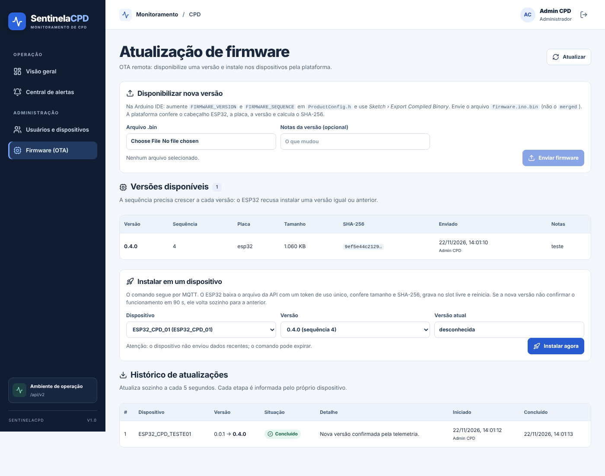 |
| Dashboard › Administração: usuários e dispositivos (ambiente de teste) | 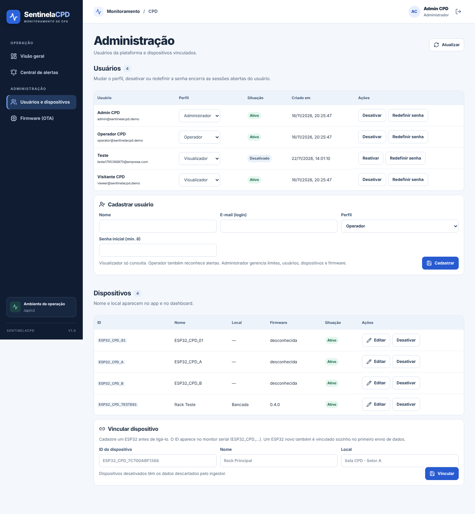 |

Testes automatizados: `tests/plataforma/teste_plataforma.py` (32 verificações), `web/tests` (7), `tests/firmware/*.cpp` (5 programas).

---

## Limitações conhecidas

Esta é a primeira versão do sistema. Estes pontos serão tratados nas próximas etapas:

* **Calibração:** os valores de corrente ainda não foram comparados com um instrumento de referência (multímetro ou alicate amperímetro).
* **Faixa de medição:** o ZMCT103C é dimensionado para correntes de até 5 A. Os testes foram feitos com cargas de poucas dezenas de miliampères, onde a resolução é menor.
* **Latência ponta a ponta:** ainda não foi medida. O campo `data_hora` registra o momento da gravação no banco e não permite calcular a latência isoladamente.
* **Firmware:** o cálculo do RMS bloqueia o laço por 200 ms a cada ciclo e a reconexão MQTT é bloqueante. Se o DHT22 falhar, a leitura do ciclo inteiro (inclusive a corrente) não é publicada.
* **Segurança da comunicação:** o broker exige usuário e senha e aplica ACL por tópico, mas o tráfego MQTT e o download do firmware ainda estão em texto claro (porta 1883 e HTTP 8000), o que só é aceitável na rede local da bancada. A integridade do firmware é garantida pelo SHA-256, não pelo canal. TLS (MQTTS 8883 e HTTPS) é o próximo passo antes de qualquer implantação fora do laboratório.
* **Eventos de energia:** o fluxo de incidentes foi validado com eventos simulados. O firmware já envia os eventos, mas a detecção real depende de ligar o PC817 e o divisor da bateria e de um ensaio de queda de energia em bancada.
* **Visualização:** a consulta aos dados é feita pelo MySQL Workbench, pela API e pelo dashboard web em desenvolvimento.

---

## Princípios de engenharia adotados

* **Separação de responsabilidades:** o microcontrolador não executa SQL, o banco não conhece o sensor e o broker cuida apenas de mensageria e roteamento.
* **Local-first e resiliência:** processamento e armazenamento ficam no perímetro local do CPD.
* **Proteção de segredos:** variáveis de ambiente em `.env` e parâmetros locais em `config.h`, ambos fora do controle de versão pelo `.gitignore`. Os arquivos `.env.example` e `config.example.h` servem de modelo.
* **Envio periódico sem `delay`:** um temporizador por software (`millis()`) controla o intervalo de 5 s no laço principal. O cálculo do RMS e a reconexão MQTT ainda são bloqueantes (ver [Limitações](#limitações-conhecidas)).
* **Infraestrutura como código:** toda a Cloud sobe com um único `docker compose up`, o que permite reproduzir o ambiente em qualquer máquina.

---

## Organização do repositório

```text
SentinelaCPD/
│
├── index.html              # GitPage (apresentação do projeto)
├── style.css               # Estilos da GitPage
├── script.js               # Scripts da GitPage
├── README.md               # Documentação técnica
├── .gitignore              # Protege segredos e arquivos temporários
│
├── images/                 # Banner, evidências e diagramas
│   ├── banner_sentinelacpd.jpg
│   ├── bancada_teste.jpg
│   ├── workbench_log.png
│   ├── diagrama_sistema.png
│   ├── esquematico_circuito.png
│   └── dashboard_*.png     # Telas de administração e firmware
│
├── firmware/               # Código C++ do ESP32 (Arduino IDE)
│   ├── firmware.ino        # Coleta, RMS, portal Wi-Fi, MQTT e OTA
│   ├── TelemetryContract.h # Tópicos, bateria, eventos de energia e JSON
│   ├── RemoteOta.h         # OTA pela dashboard: download, SHA-256, slot OTA e relatório
│   ├── RemoteOtaPolicy.h   # Validação do comando de OTA (testada no PC)
│   ├── SecureOta.h         # Saúde/rollback e OTA por manifesto assinado (desabilitado por padrão)
│   ├── PowerMonitor.h      # Presença da fonte (PC817) e tensão da bateria
│   ├── config.example.h    # Modelo de configuração (copiar para config.h)
│   └── README.md / OTA_E_ENERGIA.md
│
├── firmware-idf/           # Perfil ESP-IDF 5.5 (bootloader com rollback)
├── tools/sign_release.py   # Assinatura de releases OTA
├── tests/firmware/         # Testes C++ e Python do firmware
├── tests/plataforma/       # Teste de ponta a ponta: usuários, dispositivos e OTA
│
├── docker/                 # Backend da N1
│   ├── docker-compose.yml  # Serviços EMQX e MySQL 8.0
│   ├── .env.example        # Modelo de variáveis de ambiente
│   ├── EMQX_SETUP.md       # Configuração manual e verificação
│   └── mysql/
│       └── init.sql        # Schema de telemetria (volume novo)
│
├── web/                    # Dashboard web (React + Vite)
├── mobile/                 # App mobile (Expo SDK 58)
│
│   # Cloud da N2 (ingestão, API e alertas)
├── docker-compose.yml      # EMQX, MySQL, ingestor, api e notifier
├── .env.example            # Modelo de variáveis da Cloud (sem segredos)
├── emqx/acl.conf           # Permissões por tópico do broker
├── db/
│   └── init.sql            # Schema: dispositivos, leituras, eventos, incidentes, firmware
├── ingestor/               # Assinatura MQTT, gravação, motor de alertas e status de OTA
├── api/                    # API v2 (v2.py), administração e OTA (admin.py), v1, migração
└── notifier/               # Alertas por Telegram
```

---

## Como reproduzir o projeto

Tudo roda em um notebook ou servidor do laboratório, sem serviço pago de nuvem.

### Pré-requisitos

* **Docker** e **Docker Compose** (Docker Desktop no Windows);
* **Arduino IDE 2** com o núcleo **esp32 3.3.x** (Espressif) e as bibliotecas **PubSubClient 2.8** e **DHT sensor library** (Adafruit, que exige a *Adafruit Unified Sensor*);
* **Node.js 22** para o dashboard web (e o app **Expo Go** no celular, se for testar o app mobile);
* Placa ESP32, DHT22 e ZMCT103C ligados conforme a [pinagem](#hardware-e-pinagem) e o [esquemático](#esquemático-e-circuito-eletrônico);
* Notebook e ESP32 na **mesma rede**, sem isolamento entre aparelhos (redes de faculdade costumam isolar; um roteador de celular funciona). No Windows, libere no firewall as portas **1883** (MQTT) e **8000** (API).

```bash
git clone https://github.com/MikezinZ/SentinelaCPD.git
cd SentinelaCPD
```

### 1. Plataforma (Docker Compose)

```bash
cp .env.example .env
```

No `.env`, defina pelo menos: senhas do MySQL, `MQTT_PLATFORM_PASS`, `MQTT_DEVICE_PASS`, `JWT_SECRET` (gere com `python -c "import secrets; print(secrets.token_urlsafe(48))"`) e `ADMIN_EMAIL`/`ADMIN_PASSWORD` (ou `DEMO_USERS=true` para as contas de demonstração). Telegram é opcional.

```bash
docker compose up -d --build
docker compose ps            # 5 serviços "running"
```

| Endereço | O que é |
| --- | --- |
| `http://localhost:8000/docs` | API documentada (Swagger); botão **Authorize** aceita o token do login |
| `http://localhost:18083` | Dashboard do EMQX (troque a senha do admin no primeiro acesso) |
| porta `1883` | Broker MQTT (exige usuário e senha) |
| porta `3306` | MySQL |

Os dados ficam nos volumes `mysql_data`, `emqx_data` e `firmware_data` e continuam após `docker compose down` / `up`.

### 2. Firmware

1. Em `firmware/`, copie `config.example.h` para `config.h`.
2. Preencha `CONFIG_AP_PASSWORD` (senha do portal Wi-Fi, 12 a 63 caracteres), `MQTT_BROKER` (IP do notebook na rede, veja com `ipconfig`), `MQTT_USER "dispositivo"` e `MQTT_PASS` (= `MQTT_DEVICE_PASS` do `.env`).
3. Abra `firmware.ino`, selecione **ESP32 Dev Module** e faça o upload pelo USB. A primeira gravação leva a tabela de partições com dois slots de OTA (`partitions.csv`).
4. Configure o Wi-Fi pelo celular: conecte na rede `SentinelaCPD-<MAC>` com a senha do portal e abra `http://192.168.4.1`. A rede fica salva. Para trocar depois, segure o botão BOOT por 5 s.
5. No monitor serial (115200), aguarde `[MQTT] Conectado: ESP32_CPD_...`. O dispositivo aparece sozinho na plataforma.

Novas versões depois disso são instaladas pela dashboard, sem cabo: veja [Atualização de firmware](#atualização-de-firmware-ota-remota-pela-dashboard).

### 3. Dashboard web

```bash
cd web
npm ci
echo VITE_USE_MOCKS=false > .env.local
npm run dev
```

Abra o endereço mostrado (normalmente `http://localhost:5173`) e entre com o administrador. Sem a plataforma no ar, use `VITE_USE_MOCKS=true` para o modo de demonstração. Detalhes em [web/README.md](web/README.md).

### 4. App mobile (opcional)

Veja [mobile/README.md](mobile/README.md). Resumo: na pasta `mobile`, `npm ci`, `.env` com `EXPO_PUBLIC_USE_MOCKS=false` e `EXPO_PUBLIC_API_BASE=http://<IP do notebook>:8000/api/v2`, e `npx expo start`; abra no Expo Go.

### 5. Conferir

* Dashboard web mostra o dispositivo como **Recente**, com temperatura, umidade e versão do firmware.
* `docker compose logs -f ingestor` mostra as leituras chegando.
* Opcional: `python tests/plataforma/teste_plataforma.py firmware.ino.bin` roda as 32 verificações (precisa de `DEMO_USERS=true`).

> A pasta `docker/` guarda a infraestrutura da **N1** (EMQX gravando direto no MySQL por Data Bridge, ver [docker/EMQX_SETUP.md](docker/EMQX_SETUP.md)). Ela é só histórico: não rode as duas ao mesmo tempo, pois usam as mesmas portas.

---

## Roadmap (rumo à N2)

### Marco N1 (versão 1 — validação de bancada)

- [x] Firmware com amostragem de temperatura, umidade e corrente RMS.
- [x] Broker EMQX com autenticação e persistência em MySQL, via Docker.
- [x] Validação em bancada com carga real.
- [x] GitPage e documentação técnica.
- [x] Esquemático do circuito (mapa da protoboard e diagrama Mermaid no README).
- [x] Diagrama completo do sistema (Mermaid no README).
- [x] Diagrama completo do sistema exportado em imagem.
- [x] Esquemático de interligação do circuito exportado em imagem.

### Marco N2 e entrega final

- [x] Serviço de ingestão em Python com modelo de incidentes de energia (abertura, fechamento e duração).
- [x] API REST para o aplicativo móvel e web (API v2 com login, perfis, alertas e limites).
- [x] Alertas por Telegram (queda de energia, temperatura, dispositivo offline).
- [x] Infraestrutura da Cloud reproduzível com Docker Compose.
- [ ] Alimentação de contingência com bateria 18650 (a placa já possui suporte e circuito de carga).
- [x] Firmware publica bateria, estado da fonte e eventos `POWER_LOSS`/`POWER_RESTORED`.
- [ ] Ligar o PC817 e o divisor da bateria e validar a queda de energia real em bancada.
- [x] Dashboard web com administração de usuários e dispositivos.
- [x] Atualização de firmware pela dashboard (OTA remota, modalidade A) com SHA-256, anti-downgrade e rollback.
- [ ] Dashboard web em tempo real via WebSockets (hoje atualiza a cada 5 s).
- [ ] Consumo acumulado (kWh) e estimativa de custo.
- [x] Autenticação e ACL por tópico no MQTT.
- [ ] Comunicação criptografada com TLS (MQTTS, porta 8883) e HTTPS na API.
- [ ] Calibração da corrente com instrumento de referência e medição de latência.
- [x] `cliente_id` fixo por placa (baseado no MAC), usado também pela ACL.
- [x] Atualização OTA por manifesto assinado com RSA no firmware (alternativa, desabilitada até haver servidor HTTPS de releases).
- [x] Avaliação de Redis e de IA documentada (não adotados nesta versão, com justificativa).

---

## Licença e agradecimentos

Este projeto é distribuído sob a licença **MIT**. Consulte o arquivo `LICENSE`.

Agradecimentos ao corpo docente de Engenharia da Computação e às comunidades de software livre do **EMQX**, do **Eclipse Paho / PubSubClient** e do ecossistema **Arduino / ESP32**.

---

> **Desenvolvido por Miguel Melo, Diego Ximenes e Diogo Novaes** — Projeto Integrador 6 / Engenharia da Computação (2026.2).
