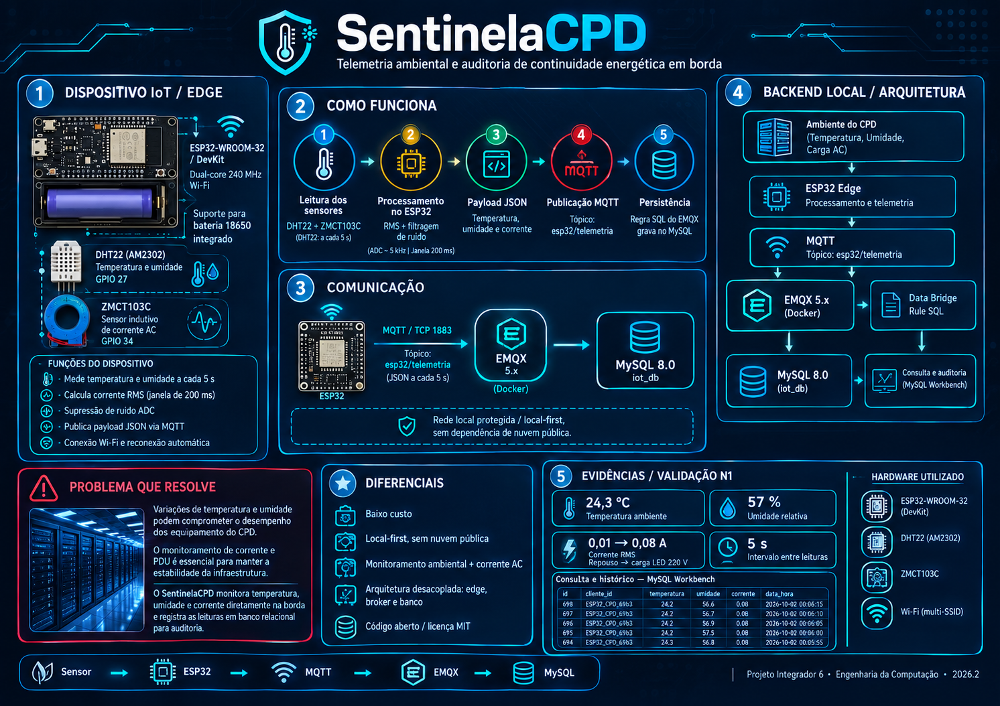
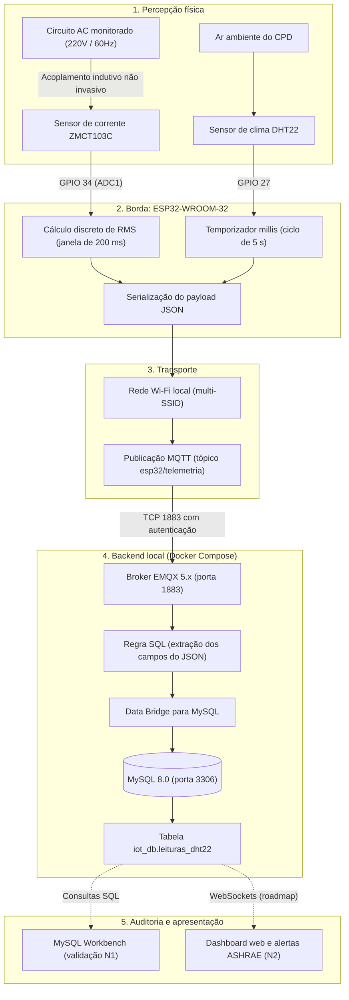
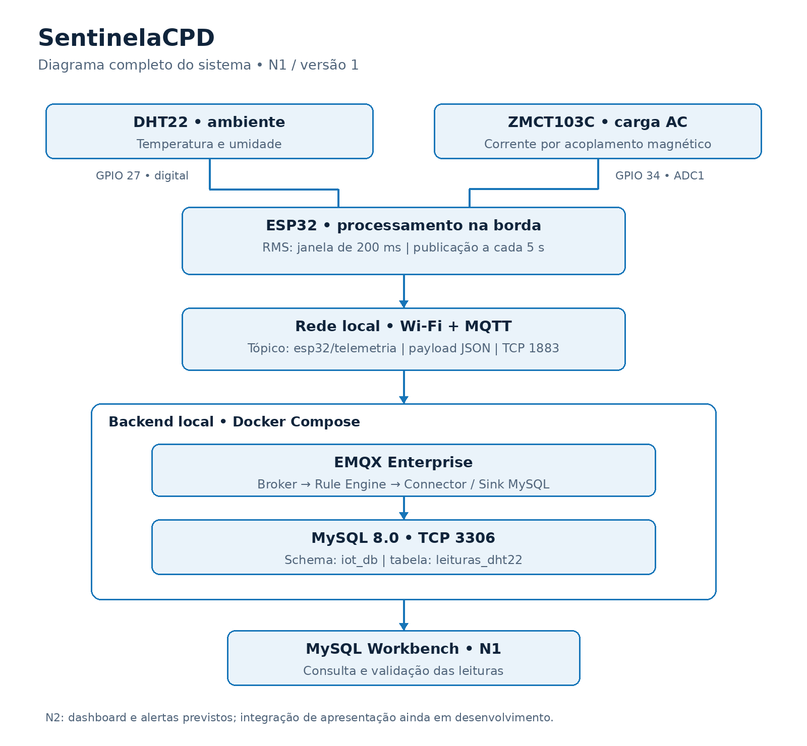
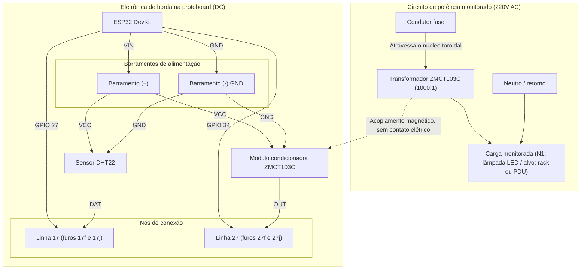
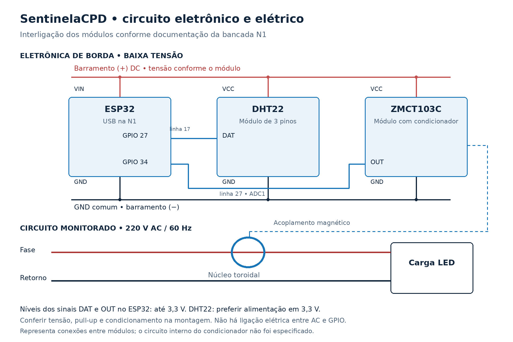
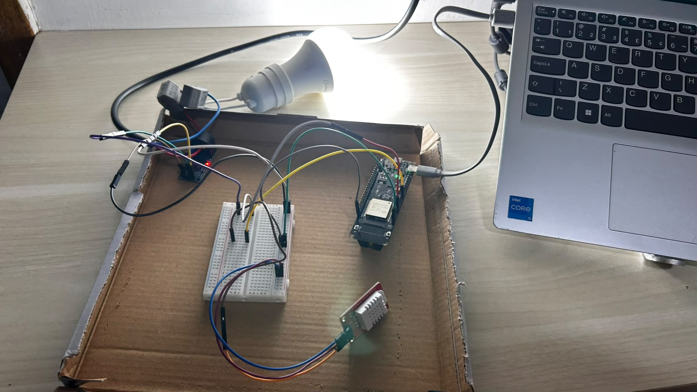
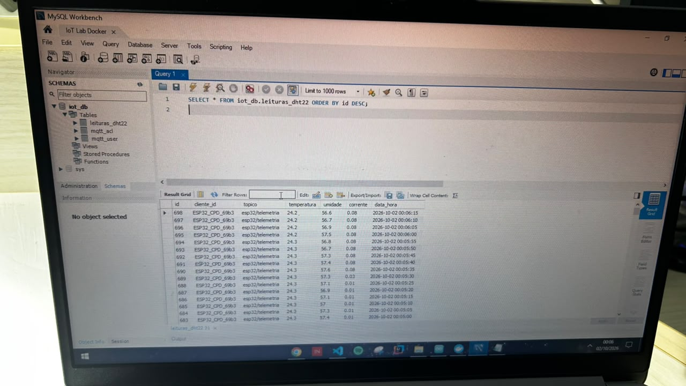
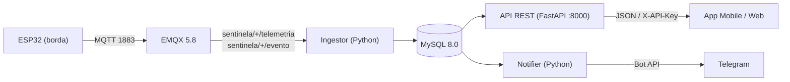

# SentinelaCPD: Telemetria Ambiental e Auditoria de Continuidade Energética em Borda

> **"A estabilidade do CPD não depende da sorte; depende da telemetria contínua na borda."**

> *Plataforma aberta de engenharia que investiga como Sistemas Embarcados, Computação de Borda e Mensageria Assíncrona podem reduzir falhas operacionais, estrangulamento térmico e interrupções de energia em Centros de Processamento de Dados.*




**🔗 GitPage:** [mikezinz.github.io/SentinelaCPD](https://mikezinz.github.io/SentinelaCPD/)  
**📦 Repositório:** [github.com/MikezinZ/SentinelaCPD](https://github.com/MikezinZ/SentinelaCPD)
**Dashboard web:** [demonstração pública](https://sentinela-cpd.arisenalto1.chatgpt.site) · [código e instruções](web/README.md)

---

## 📌 Status do Projeto: Entrega N1 (v1) e Cloud N2 em andamento

O SentinelaCPD concluiu sua **primeira etapa de validação física e arquitetural (N1)** no Projeto Integrador 6 (Engenharia da Computação, 2026.2).

Nesta etapa, a plataforma coleta temperatura e umidade e calcula a corrente alternada eficaz ($I_{\text{RMS}}$) em um circuito de 220 V AC. Os dados seguem de um nó ESP32 até um broker MQTT (EMQX) em Docker e são gravados em um banco MySQL, onde podem ser consultados para auditoria.

A N1 é uma **validação de bancada** do conceito e **uma parte do projeto**. A instalação em um CPD real, a calibração com instrumento de referência, a alimentação por bateria e o TLS estão previstos para etapas posteriores (ver [limitações](#limitações-conhecidas) e [roadmap](#roadmap-rumo-à-n2)).

Na etapa N2, a camada de **Cloud** já tem implementados o serviço de ingestão, o modelo de incidentes de energia, a **API REST** para o aplicativo móvel e os **alertas por Telegram**. Veja a seção [Cloud: ingestão, API e alertas (N2)](#cloud-ingestão-api-e-alertas-n2).

---

## 📑 Sumário

1. [Por que o SentinelaCPD?](#por-que-o-sentinelacpd)
2. [Motivação de engenharia](#motivação-de-engenharia)
3. [Objetivos e critérios de validação da N1](#objetivos-e-critérios-de-validação-da-n1)
4. [Stack tecnológica](#stack-tecnológica)
5. [Visão do sistema e arquitetura](#visão-do-sistema-e-arquitetura)
6. [Fundamentação matemática: RMS](#fundamentação-matemática-cálculo-discreto-de-rms)
7. [Hardware e pinagem](#hardware-e-pinagem)
8. [Esquemático e circuito eletrônico](#esquemático-e-circuito-eletrônico)
9. [Resultados experimentais (N1)](#resultados-experimentais-n1)
10. [Cloud: ingestão, API e alertas (N2)](#cloud-ingestão-api-e-alertas-n2)
11. [Limitações conhecidas](#limitações-conhecidas)
12. [Princípios de engenharia](#princípios-de-engenharia-adotados)
13. [Organização do repositório](#organização-do-repositório)
14. [Como reproduzir](#como-reproduzir-o-projeto)
15. [Roadmap](#roadmap-rumo-à-n2)
16. [Licença](#licença-e-agradecimentos)

---

## Por que o SentinelaCPD?

Servidores e equipamentos de rede raramente avisam quando vão falhar.

Tradicionalmente, a infraestrutura física de TI opera em silos: o ar-condicionado tem seu termostato, os nobreaks (UPS) têm interfaces proprietárias e os técnicos só olham as telas depois do incidente (*downtime*).

Quando a climatização falha de madrugada ou uma tomada de distribuição (PDU) sofre sobrecorrente, a inércia térmica de um rack é curta. Em poucos minutos pode ocorrer *thermal throttling*, degradação de componentes ou desligamento abrupto de servidores.

O SentinelaCPD parte de uma pergunta:

> **Como transformar o ambiente do CPD em um sistema sensorial capaz de auditar continuamente variáveis térmicas e a presença/consumo de energia diretamente na borda?**

A resposta proposta é uma arquitetura de baixo custo, orientada a eventos e *local-first*, em vez de soluções industriais fechadas e caras.

---

## Motivação de engenharia

Ambientes de missão crítica seguem referências como as da **ASHRAE (TC 9.9)**, que recomenda temperatura de bulbo seco entre $18^\circ\text{C}$ e $27^\circ\text{C}$ para CPDs. Para umidade, as edições atuais usam ponto de orvalho; neste projeto adotamos $40\%$ a $60\%$ de umidade relativa como faixa prática de referência.

Três pilares sustentam o trabalho:

1. **Prevenção de hotspots térmicos:** mapear o microclima próximo aos racks antes que o calor residual atinja níveis destrutivos.
2. **Auditoria de carga e continuidade elétrica:** detectar a presença ou o corte de alimentação em circuitos-chave com sensoriamento indutivo não invasivo.
3. **Soberania e desacoplamento:** manter o pipeline de telemetria funcionando em rede local restrita, sem depender de nuvens públicas.

---

## Objetivos e critérios de validação da N1

A primeira versão do SentinelaCPD tem como objetivos:

1. Adquirir temperatura e umidade do ambiente.
2. Adquirir a corrente alternada por sensoriamento indutivo.
3. Calcular a corrente RMS no dispositivo de borda.
4. Transmitir as leituras por MQTT.
5. Receber e processar as mensagens no EMQX.
6. Persistir as informações em um banco MySQL.
7. Permitir a consulta e a auditoria das leituras armazenadas.
8. Validar fisicamente o funcionamento do pipeline completo.
9. Documentar a arquitetura, o circuito, o firmware e o processo de reprodução.

| Requisito | Implementação | Situação |
| --- | --- | :---: |
| Aquisição de temperatura e umidade | DHT22 | ✅ |
| Medição de corrente AC | ZMCT103C | ✅ |
| Cálculo de corrente RMS | ESP32 | ✅ |
| Comunicação sem fio | Wi-Fi | ✅ |
| Mensageria | MQTT 3.1.1 | ✅ |
| Broker e autenticação MQTT | EMQX 5.x | ✅ |
| Infraestrutura | Docker / Docker Compose | ✅ |
| Ingestão no banco | Data Bridge / regra SQL | ✅ |
| Persistência | MySQL 8.0 | ✅ |
| Validação dos dados | MySQL Workbench | ✅ |
| Teste físico | Cargas LED em 220 V AC | ✅ |
| API REST para o aplicativo | FastAPI (ver [Cloud](#cloud-ingestão-api-e-alertas-n2)) | ✅ N2 |
| Alertas por Telegram | Serviço `notifier` (ver [Cloud](#cloud-ingestão-api-e-alertas-n2)) | ✅ N2 |
| Dashboard em tempo real | — | 🔄 N2 |
| TLS/MQTTS | — | 🔄 N2 |

---

## Stack tecnológica

| Camada | Tecnologia | Papel no projeto |
| --- | --- | --- |
| **Hardware** | ESP32-WROOM-32 (placa com suporte 18650), DHT22 (AM2302), ZMCT103C | Microcontrolador dual-core com Wi-Fi e sensores de temperatura, umidade e corrente AC |
| **Firmware** | C++ (Arduino Core, que roda sobre FreeRTOS) | Amostragem, cálculo de RMS, formatação do payload e conexão de rede |
| **Bibliotecas** | `WiFi` / `WiFiMulti`, `PubSubClient`, `DHT` (`DHT.h`) | Conexão Wi-Fi multi-SSID, cliente MQTT e leitura do DHT22 |
| **Formato de dados** | JSON | Payload leve com temperatura, umidade e corrente |
| **Mensageria** | MQTT 3.1.1 sobre TCP (porta 1883), EMQX 5.x | Broker local, autenticação de dispositivo e regras SQL |
| **Persistência** | MySQL 8.0 | Armazenamento relacional de séries temporais |
| **Cloud (N2)** | Python 3 (`paho-mqtt`, `mysql-connector-python`), FastAPI + Uvicorn | Serviço de ingestão, modelo de incidentes, API REST e notificações |
| **Alertas (N2)** | Telegram Bot API | Avisos de queda de energia, temperatura e dispositivo offline |
| **Infraestrutura** | Docker e Docker Compose | Sobe EMQX, MySQL, ingestão, API e alertas de forma reproduzível |
| **Ferramentas** | MySQL Workbench, Arduino IDE | Consulta e auditoria dos dados; gravação do firmware |
| **Apresentação** | HTML, CSS e JavaScript (GitHub Pages) | Documentação pública do projeto |
| **Versionamento** | Git e GitHub | Controle de código; segredos fora do repositório |

---

## Visão do sistema e arquitetura

O SentinelaCPD é um **pipeline de dados contínuo**, projetado para:

* Amostrar periodicamente temperatura e umidade do ar;
* Calcular o valor eficaz (RMS) da corrente AC em janelas de 200 ms;
* Descartar o ruído do ADC quando não há carga;
* Montar payloads JSON leves;
* Reconectar sozinho ao Wi-Fi e ao broker;
* Persistir as leituras em banco relacional para auditoria.

### Diagrama completo do sistema

Todo o fluxo opera na rede local do CPD, sem dependência de serviços em nuvem. Percepção, roteamento de mensagens e armazenamento ficam desacoplados.





O ESP32 publica a cada 5 segundos um payload JSON como este:

```json
{"temperatura": 24.3, "umidade": 57.1, "corrente": 0.08}
```

### Camadas e responsabilidades

```text
+-------------------------------------------------------------------+
|                     Camada de Percepção (Sensing)                 |
|     [ DHT22: Temp/Umidade ]       [ ZMCT103C: Corrente AC ]       |
+---------------------------------+---------------------------------+
                                  │
                                  ▼
+-------------------------------------------------------------------+
|                   Camada de Borda (Edge Processing)               |
|                  ESP32 dual-core @ 240 MHz                        |
|   - Janela de 200 ms (~12 ciclos de 60 Hz) - Cálculo RMS          |
|   - Supressão de ruído do ADC              - Wi-Fi multi-SSID     |
+---------------------------------+---------------------------------+
                                  │ MQTT · TCP 1883
                                  ▼
+-------------------------------------------------------------------+
|               Camada de Mensageria e Ingestão (Docker)            |
|                            EMQX 5.x                               |
|   - Autenticação de dispositivo     - Parse JSON via regra SQL    |
+---------------------------------+---------------------------------+
                                  │ Data Bridge
                                  ▼
+-------------------------------------------------------------------+
|                  Camada de Persistência e Auditoria               |
|                         MySQL Database 8.0                        |
|   - Série temporal (leituras_dht22)                               |
|   - Consulta e validação via MySQL Workbench                      |
+-------------------------------------------------------------------+
```

### Responsabilidades por camada

| Camada | Componentes | Protocolo / barramento | Responsabilidade |
| --- | --- | --- | --- |
| **1. Percepção** | DHT22, ZMCT103C | Indução magnética / digital de 1 fio | Sensoriamento não invasivo de corrente e do microclima. |
| **2. Borda** | ESP32-WROOM-32 | GPIO 27, GPIO 34 (ADC1) | Aquisição, cálculo do $I_{\text{RMS}}$ e montagem do payload JSON. |
| **3. Transporte** | Wi-Fi 802.11 b/g/n | MQTT 3.1.1 sobre TCP (1883) | Publicação periódica com reconexão automática. |
| **4a. Mensageria** | EMQX 5.x (Docker) | MQTT e regra SQL | Autenticação de dispositivo, roteamento e ingestão no banco via Data Bridge. |
| **4b. Persistência** | MySQL 8.0 (Docker) | TCP 3306 / SQL | Armazenamento relacional da série temporal. |
| **5. Auditoria** | MySQL Workbench (N1), dashboard web (N2) | SQL / WebSockets | Validação dos dados na N1; visualização e alertas na N2. |

---

## Fundamentação matemática: cálculo discreto de RMS

O **ZMCT103C** é um transformador de corrente em miniatura. Como a corrente alternada é senoidal a $60\text{ Hz}$ ($T \approx 16{,}7\text{ ms}$), a média aritmética do sinal é próxima de zero e não serve como medida. O firmware calcula o valor eficaz em uma janela de $200\text{ ms}$ (cerca de 12 ciclos completos):

$$I_{\text{RMS}} = \sqrt{\frac{1}{N} \sum_{i=1}^{N} (x_i - \mu)^2} \cdot K$$

Em que:

* $N$: número de amostras na janela de $200\text{ ms}$ (taxa aproximada de $4$ a $5\text{ kHz}$, limitada pelo tempo de cada leitura do ADC);
* $x_i$: leitura bruta do ADC de 12 bits ($0$ a $4095$);
* $\mu$: média das amostras da própria janela, que remove o *offset* DC de polarização (observado em torno de 1680);
* $K$: constante de calibração que converte o valor do ADC em ampères. Ela depende da relação do transformador, do resistor de carga e do ganho do condicionamento de sinal, e é ajustada empiricamente.

### Supressão de piso de ruído

Com carga em repouso, o ADC do ESP32 ainda apresenta flutuações (ruído de quantização e de alimentação). Para evitar leituras espúrias, aplica-se um limiar sobre o desvio-padrão das amostras:

$$\text{Se } \sigma_{\text{ADC}} < 18{,}0 \implies I_{\text{RMS}} = 0{,}00\text{ A}$$

Com $K = 0{,}00055$ (valor de exemplo em `config.example.h`), esse limiar equivale a cerca de $0{,}0099\text{ A}$. Quando o ruído oscila logo acima dele, o sistema registra um piso residual de ~`0.01 A`, que é **ruído do ADC e não corrente real**.

---

## Hardware e pinagem

| Módulo | Interface elétrica | Pino ESP32 | Observações |
| --- | --- | --- | --- |
| **ESP32-WROOM-32** (placa com suporte 18650) | MCU / Wi-Fi | Micro-USB | Na N1, alimentação e gravação via USB. O suporte 18650 e o circuito de carga da placa **não são usados** nesta etapa. |
| **DHT22 (AM2302)** | Digital, 1 fio | **GPIO 27** | O módulo de 3 pinos já inclui o resistor de pull-up. No sensor de 4 pinos, use pull-up externo de 4,7 a 10 kΩ. Leitura a cada 5 s. Prefira alimentar em 3,3 V, para que o nível do pino de dados não ultrapasse 3,3 V no ESP32. |
| **ZMCT103C** | Analógico com offset DC | **GPIO 34 (ADC1)** | ADC1 evita conflito com o rádio Wi-Fi. A saída do módulo **não pode passar de 3,3 V** no pino do ESP32. Confira com multímetro a tensão no ponto médio da saída. |
| **Barramento de alimentação** | DC | 3V3 / 5V / GND | Trilhas dedicadas da protoboard. |
| **Circuito AC (220 V)** | Acoplamento magnético | Isolado | Apenas o condutor **fase** atravessa o toroide. O sensor não faz contato elétrico com o circuito. |

> ⚠️ **Segurança:** o teste envolve tensão de rede (220 V AC). Mantenha emendas e conexões do cabo de carga isoladas e afastadas da protoboard e do notebook. Nunca manipule o circuito energizado.

---

## Esquemático e circuito eletrônico

O sistema separa a eletrônica de borda (DC, baixa tensão) da linha de potência monitorada (220 V AC / 60 Hz). O isolamento galvânico é dado pelo próprio transformador de corrente do ZMCT103C: o condutor fase atravessa o toroide e o sinal chega ao ESP32 apenas por acoplamento magnético. As ligações entre o microcontrolador e os sensores usam os barramentos de alimentação e as linhas 17 e 27 da protoboard.

> Na N1, a carga monitorada foi uma lâmpada/painel LED (ver [Resultados experimentais](#resultados-experimentais-n1)). Na aplicação-alvo, o mesmo condutor seria o circuito de alimentação de um rack ou PDU.

### Mapeamento físico da protoboard

```text
===================== BARRAMENTO SUPERIOR (+) =====================
 [Barramento (+)] ────┬──────────────────┬──────────────────┐
                      │                  │                  │
                      ▼                  ▼                  ▼
                 [ESP32 VIN]        [DHT22 VCC]      [ZMCT103C VCC]

===================== BARRAMENTO INFERIOR (-) =====================
 [Barramento (-)] ────┬──────────────────┬──────────────────┐
                      │                  │                  │
                      ▼                  ▼                  ▼
                 [ESP32 GND]        [DHT22 GND]      [ZMCT103C GND]

========================== NÓS DE SINAL ===========================

 Linha 17 (barramento de dados do DHT22):
 [ESP32 GPIO 27] ──► Furo 17f ═══ (trilha interna 17) ═══ Furo 17j ◄── [DHT22 DAT]

 Linha 27 (canal analógico ADC1 do ZMCT103C):
 [ESP32 GPIO 34] ──► Furo 27f ═══ (trilha interna 27) ═══ Furo 27j ◄── [ZMCT103C OUT]

========================= ISOLAMENTO GALVÂNICO ====================

 Condutor fase (220 V) ──► ( Furo toroidal do ZMCT103C ) ──► Carga monitorada
                               [Acoplamento indutivo]
```

### Esquemático estrutural do sistema





A imagem representa as conexões documentadas entre os módulos; não especifica o circuito interno do condicionador. Confira alimentação e níveis de sinal conforme a seção de pinagem.

### Matriz de conexões e roteamento físico

| Dispositivo | Terminal | Ponto na protoboard | Destino | Domínio / interface | Função técnica |
| --- | --- | --- | --- | --- | --- |
| **ESP32** | `VIN` | Barramento (`+`) | Trilhas de alimentação | 5 V DC (da USB) | Fornece a tensão de 5 V ao barramento (+), alimentado via USB na N1. |
| **ESP32** | `GND` | Barramento (`-`) | Barramento de retorno | 0 V DC | Terra comum e referência de sinal. |
| **ESP32** | `GPIO 27` | Furo `17f` | Linha 17 (furo `17j`) | Digital, 1 fio | Linha de dados do sensor térmico. |
| **DHT22** | `DAT` | Furo `17j` | Linha 17 (furo `17f`) | Digital, 1 fio | Envio dos dados de temperatura e umidade. |
| **DHT22** | `VCC` | Barramento (`+`) | Trilhas de alimentação | Tensão do barramento (+) | Alimentação do sensor climático. |
| **DHT22** | `GND` | Barramento (`-`) | Barramento de retorno | 0 V DC | Terra do sensor. |
| **ESP32** | `GPIO 34` | Furo `27f` | Linha 27 (furo `27j`) | Analógico (ADC1) | Aquisição contínua para o cálculo do $I_{\text{RMS}}$. |
| **ZMCT103C** | `OUT` | Furo `27j` | Linha 27 (furo `27f`) | Analógico (sinal AC com offset) | Tensão senoidal proporcional à corrente, centrada no ponto médio de polarização. |
| **ZMCT103C** | `VCC` | Barramento (`+`) | Trilhas de alimentação | Tensão do barramento (+) | Alimentação do condicionador de sinal do módulo. |
| **ZMCT103C** | `GND` | Barramento (`-`) | Barramento de retorno | 0 V DC | Referência do circuito de condicionamento. |
| **Linha AC** | Condutor fase | Furo toroidal | Carga monitorada | 220 V AC / 60 Hz | Leitura por indução eletromagnética, sem contato elétrico. |

> **Observação:** a tensão do barramento (+) deve respeitar os limites de nível lógico descritos em [Hardware e pinagem](#hardware-e-pinagem): DHT22 preferencialmente em 3,3 V e saída do ZMCT103C sempre abaixo de 3,3 V no pino do ESP32.
> As linhas 17 e 27 ligam o pino do ESP32 ao sensor na mesma tira de contatos (furos `f` a `j`), sem jumpers adicionais.

---

## Resultados experimentais (N1)

Foram feitos dois testes de bancada com cargas LED de 220 V AC passando pelo sensor de corrente. Os registros foram gravados no MySQL pela regra do EMQX.

### Teste 1: painel LED de 18 W (27/09/2026)

```sql
SELECT id, cliente_id, temperatura, umidade, corrente, data_hora
FROM iot_db.leituras_dht22
ORDER BY id;
-- trecho dos registros; ids 444 a 447 omitidos por brevidade
```

```text
+-----+----------------+-------------+---------+----------+---------------------+
| id  | cliente_id     | temperatura | umidade | corrente | data_hora           |
+-----+----------------+-------------+---------+----------+---------------------+
| 440 | ESP32_CPD_8544 | 30.9        | 67.6    | 0.00     | 2026-09-27 15:46:37 |
| 441 | ESP32_CPD_8544 | 30.9        | 67.6    | 0.13     | 2026-09-27 15:46:42 |
| 442 | ESP32_CPD_8544 | 31.0        | 67.4    | 0.12     | 2026-09-27 15:46:47 |
| 443 | ESP32_CPD_8544 | 31.0        | 67.0    | 0.13     | 2026-09-27 15:46:52 |
| 448 | ESP32_CPD_8544 | 31.0        | 66.9    | 0.00     | 2026-09-27 15:47:17 |
+-----+----------------+-------------+---------+----------+---------------------+
```

* **Sem carga:** leitura de `0.00 A`.
* **Carga ligada:** leitura estável em torno de `0.13 A`.

### Teste 2: lâmpada LED de bulbo (02/10/2026)



*Montagem de bancada: o condutor fase atravessa o toroide do ZMCT103C, sem contato elétrico com o circuito lógico.*



*Registros no banco `iot_db` mostrando a transição de estado da corrente, gravados pelo Data Bridge.*

```text
+-----+----------------+-------------------+-------------+---------+----------+---------------------+
| id  | cliente_id     | topico            | temperatura | umidade | corrente | data_hora           |
+-----+----------------+-------------------+-------------+---------+----------+---------------------+
| 698 | ESP32_CPD_69b3 | esp32/telemetria  | 24.2        | 56.6    | 0.08     | 2026-10-02 00:06:15 |
| 697 | ESP32_CPD_69b3 | esp32/telemetria  | 24.2        | 56.7    | 0.08     | 2026-10-02 00:06:10 |
| 696 | ESP32_CPD_69b3 | esp32/telemetria  | 24.2        | 56.9    | 0.08     | 2026-10-02 00:06:05 |
| 695 | ESP32_CPD_69b3 | esp32/telemetria  | 24.2        | 57.5    | 0.08     | 2026-10-02 00:06:00 |
| 694 | ESP32_CPD_69b3 | esp32/telemetria  | 24.3        | 56.8    | 0.08     | 2026-10-02 00:05:55 |
| 693 | ESP32_CPD_69b3 | esp32/telemetria  | 24.3        | 56.7    | 0.08     | 2026-10-02 00:05:50 |
| 692 | ESP32_CPD_69b3 | esp32/telemetria  | 24.3        | 57.3    | 0.08     | 2026-10-02 00:05:45 |
| 691 | ESP32_CPD_69b3 | esp32/telemetria  | 24.3        | 57.4    | 0.08     | 2026-10-02 00:05:40 |
| 690 | ESP32_CPD_69b3 | esp32/telemetria  | 24.3        | 57.6    | 0.08     | 2026-10-02 00:05:35 |
| 689 | ESP32_CPD_69b3 | esp32/telemetria  | 24.3        | 57.3    | 0.03     | 2026-10-02 00:05:30 |
| 688 | ESP32_CPD_69b3 | esp32/telemetria  | 24.3        | 57.1    | 0.01     | 2026-10-02 00:05:25 |
| 687 | ESP32_CPD_69b3 | esp32/telemetria  | 24.3        | 56.9    | 0.01     | 2026-10-02 00:05:20 |
| 686 | ESP32_CPD_69b3 | esp32/telemetria  | 24.3        | 57.1    | 0.01     | 2026-10-02 00:05:15 |
| 685 | ESP32_CPD_69b3 | esp32/telemetria  | 24.3        | 57.0    | 0.01     | 2026-10-02 00:05:10 |
| 684 | ESP32_CPD_69b3 | esp32/telemetria  | 24.3        | 57.3    | 0.01     | 2026-10-02 00:05:05 |
| 683 | ESP32_CPD_69b3 | esp32/telemetria  | 24.3        | 57.4    | 0.01     | 2026-10-02 00:05:00 |
+-----+----------------+-------------------+-------------+---------+----------+---------------------+
```

* **Sem carga:** a corrente ficou em um piso residual de `0.01 A` (registros 683 a 688), que corresponde ao [piso de ruído do ADC](#supressão-de-piso-de-ruído).
* **Transição:** ao ligar a carga, a leitura passou por `0.03 A` (registro 689) e estabilizou em `0.08 A` a partir do registro 690.
* **Ambiente:** temperatura em torno de `24.3 °C` e umidade em torno de `57 %`, com leituras regulares a cada 5 s e sem perda de registros no trecho mostrado.

> Os dois testes usaram cargas diferentes, por isso os valores de corrente diferem. O `cliente_id` muda entre os testes porque o firmware gera um ID aleatório a cada conexão MQTT.

---

## Cloud: ingestão, API e alertas (N2)

A camada de Cloud transforma a telemetria bruta da N1 em **informação de operação**: estado do CPD, incidentes de energia com duração, API para o aplicativo móvel e alertas ativos. Ela roda inteira em Docker Compose, na rede local, e foi validada de ponta a ponta com um ESP32 real (DHT22 → Wi-Fi → EMQX → MySQL → API → Telegram).

> **Responsável:** Diogo Novaes. O código fica na raiz do repositório: `api/`, `ingestor/`, `notifier/`, `db/` e o `docker-compose.yml`.

### Arquitetura



| Serviço | Imagem / tecnologia | Responsabilidade |
| --- | --- | --- |
| `emqx` | `emqx/emqx:5.8.0` | Broker MQTT (1883), dashboard (18083) e WebSocket (8083) |
| `mysql` | `mysql:8.0` | Persistência; schema criado por `db/init.sql` |
| `ingestor` | Python + `paho-mqtt` | Assina os tópicos, valida faixas, grava leituras e abre/fecha incidentes |
| `api` | FastAPI + Uvicorn | Endpoints REST para o aplicativo, com CORS e `X-API-Key` opcional |
| `notifier` | Python (`urllib`) | Consulta o banco a cada 5 s e envia alertas ao Telegram |

> Na N1 a gravação era feita por Data Bridge e regra SQL do EMQX. Na Cloud, a ingestão passou para um serviço próprio (`ingestor`), porque o Data Bridge não expressa a lógica de **incidentes** (abrir, fechar e calcular duração) nem valida os dados. O tópico legado `esp32/telemetria` continua aceito e é gravado como `ESP32_CPD_01`.

### Contrato de mensagens MQTT

| Tópico | Payload |
| --- | --- |
| `sentinela/<id>/telemetria` | `{"temperatura":27.8,"umidade":45.4,"corrente":0.8,"bateria":87}` (campos opcionais) |
| `sentinela/<id>/evento` | `{"evento":"POWER_LOSS","estado":"ON_BATTERY","temperatura":29.4,"umidade":58.2,"bateria":87}` |
| `esp32/telemetria` | legado da N1, sem id |

Eventos válidos: `POWER_LOSS`, `LAST_GASP` e `POWER_RESTORED`. `POWER_LOSS` e `LAST_GASP` abrem um incidente de queda de energia e colocam o dispositivo em `ON_BATTERY`; `POWER_RESTORED` fecha o incidente e calcula a duração.

### Modelo de dados

| Tabela | Conteúdo |
| --- | --- |
| `dispositivos` | id, nome, local, estado, criado_em, ultimo_contato |
| `leituras` | dispositivo_id, temperatura, umidade, corrente, bateria, data_hora |
| `eventos` | dispositivo_id, tipo, payload (JSON), data_hora |
| `incidentes` | dispositivo_id, tipo (`QUEDA_ENERGIA`), status (`ABERTO`/`FECHADO`), inicio, fim, duracao_s |
| `notificacoes` | controle de alertas já enviados, para não repetir (chave única `tipo` + `referencia_id`) |

### API REST (para o aplicativo)

Documentação interativa em `http://<host>:8000/docs`. Se `API_KEY` estiver definida no `.env`, envie o cabeçalho `X-API-Key` nas rotas `/api`.

| Rota | O que devolve |
| --- | --- |
| `GET /health` | API e banco no ar (sem chave) |
| `GET /api/status-cpd` | situação geral e último valor de cada dispositivo (online, alerta de temperatura, incidentes abertos) |
| `GET /api/telemetria?dispositivo=&de=&ate=&limite=` | histórico, mais recente primeiro (máx. 1000) |
| `GET /api/incidentes?dispositivo=&status=&limite=` | lista de incidentes com duração |
| `GET /api/incidentes/{id}` | incidente e eventos ocorridos nele |
| `GET /api/dispositivos` | dispositivos cadastrados |

`status_geral` assume `NORMAL`, `EM_INCIDENTE`, `ALERTA_TEMPERATURA`, `OFFLINE` ou `SEM_DADOS`. Um dispositivo fica `online: false` após `ONLINE_TIMEOUT_S` (30 s) sem enviar dados.

### Alertas por Telegram

| Situação | Aviso |
| --- | --- |
| Incidente de energia aberto | 🔴 queda de energia detectada |
| Incidente fechado | 🟢 energia restabelecida, com a duração |
| Temperatura acima de `TEMP_LIMITE` | 🌡️ alerta; avisa também quando normaliza (histerese de 1 °C) |
| Dispositivo sem dados por `OFFLINE_S` | ⚠️ dispositivo offline; avisa quando volta |

Detalhes de projeto: um alerta de offline só é emitido para dispositivo que já esteve online, a tabela `notificacoes` evita duplicidade, incidentes anteriores à primeira execução não geram avisos antigos e o token nunca é escrito no log. Sem token, o serviço roda em modo teste e apenas registra as mensagens.

### Como subir

```bash
cp .env.example .env        # defina senhas, TELEGRAM_TOKEN e TELEGRAM_CHAT_ID
docker compose up -d --build
docker compose logs -f ingestor
```

Variáveis (`.env.example`): `MYSQL_*`, `API_KEY`, `TEMP_LIMITE` (35), `ONLINE_TIMEOUT_S` (30), `OFFLINE_S` (60), `TELEGRAM_TOKEN`, `TELEGRAM_CHAT_ID`.

> 🔒 O arquivo `.env` contém senhas e o token do bot. Ele está no `.gitignore` e **nunca** deve ser publicado. Se o token vazar, gere outro com `/revoke` no `@BotFather`.

Teste sem o ESP32:

```bash
mosquitto_pub -h localhost -t sentinela/ESP32_CPD_01/telemetria -m '{"temperatura":27.8,"umidade":45.4}'
mosquitto_pub -h localhost -t sentinela/ESP32_CPD_01/evento -m '{"evento":"POWER_LOSS"}'
mosquitto_pub -h localhost -t sentinela/ESP32_CPD_01/evento -m '{"evento":"POWER_RESTORED"}'
```

### O que foi validado

* ✅ ESP32 real publicando temperatura e umidade a cada 5 s até o banco e a API.
* ✅ Abertura e fechamento de incidente (via evento MQTT) com cálculo de duração e alertas no Telegram.
* ✅ Alerta de dispositivo offline e de retorno.
* ✅ API consultada pelo Swagger e pelo navegador.
* ⏳ Não testado ao vivo: alerta de temperatura (apenas simulado em teste automatizado).
* ⏳ Os eventos de queda de energia foram **simulados** por publicação MQTT, sem corte real de energia. O firmware da Cloud ainda não envia `corrente` e `bateria`.

### Decisões de arquitetura e próximos passos

Itens abaixo são **propostas**; ainda não estão implementados.

| Tema | Decisão |
| --- | --- |
| Banco de dados | Manter MySQL no volume atual; migrar para TimescaleDB se o volume de séries temporais crescer. MongoDB descartado: o modelo é relacional (dispositivo, leitura, incidente). |
| Redis | Cache do último estado por dispositivo, rate limit e pub/sub para empurrar eventos ao app. |
| OTA | Atualização por HTTPS disparada via MQTT, partições duplas, verificação SHA-256 e rollback automático. |
| Segurança | Usuário/senha e ACL por tópico no EMQX, depois TLS (8883); JWT na API; backup e retenção de dados. |
| IA | Abordagem híbrida: regras e z-score para anomalias simples, Isolation Forest para padrões multivariados. |
| Tempo real | WebSocket ou push para o aplicativo, em substituição ao polling. |

---

## Limitações conhecidas

Esta é a primeira versão do sistema. Estes pontos serão tratados nas próximas etapas:

* **Calibração:** os valores de corrente ainda não foram comparados com um instrumento de referência (multímetro ou alicate amperímetro).
* **Faixa de medição:** o ZMCT103C é dimensionado para correntes de até 5 A. Os testes foram feitos com cargas de poucas dezenas de miliampères, onde a resolução é menor.
* **Latência ponta a ponta:** ainda não foi medida. O campo `data_hora` registra o momento da gravação no banco e não permite calcular a latência isoladamente.
* **Firmware:** o cálculo do RMS bloqueia o laço por 200 ms a cada ciclo e a reconexão MQTT é bloqueante. Se o DHT22 falhar, a leitura do ciclo inteiro (inclusive a corrente) não é publicada.
* **Segurança da comunicação:** o tráfego MQTT ainda está em texto claro (porta 1883). TLS está previsto para a N2. Na stack de Cloud em fase de testes, o broker ainda não exige usuário e senha.
* **Eventos de energia:** o fluxo de incidentes foi validado com eventos simulados; a detecção real (Last-Gasp com bateria) depende da integração do firmware.
* **Visualização:** a consulta aos dados é feita pelo MySQL Workbench, pela API e pelo dashboard web em desenvolvimento.

---

## Princípios de engenharia adotados

* **Separação de responsabilidades:** o microcontrolador não executa SQL, o banco não conhece o sensor e o broker cuida apenas de mensageria e roteamento.
* **Local-first e resiliência:** processamento e armazenamento ficam no perímetro local do CPD.
* **Proteção de segredos:** variáveis de ambiente em `.env` e parâmetros locais em `config.h`, ambos fora do controle de versão pelo `.gitignore`. Os arquivos `.env.example` e `config.example.h` servem de modelo.
* **Envio periódico sem `delay`:** um temporizador por software (`millis()`) controla o intervalo de 5 s no laço principal. O cálculo do RMS e a reconexão MQTT ainda são bloqueantes (ver [Limitações](#limitações-conhecidas)).
* **Infraestrutura como código:** toda a Cloud sobe com um único `docker compose up`, o que permite reproduzir o ambiente em qualquer máquina.

---

## Organização do repositório

```text
SentinelaCPD/
│
├── index.html              # GitPage (apresentação do projeto)
├── style.css               # Estilos da GitPage
├── script.js               # Scripts da GitPage
├── README.md               # Documentação técnica
├── .gitignore              # Protege segredos e arquivos temporários
│
├── images/                 # Banner, evidências e diagramas
│   ├── banner_sentinelacpd.jpg
│   ├── bancada_teste.jpg
│   ├── workbench_log.png
│   ├── diagrama_sistema.png
│   └── esquematico_circuito.png
│
├── firmware/               # Código C++ do ESP32
│   ├── firmware.ino        # Amostragem, RMS e loop MQTT
│   └── config.example.h    # Modelo de configuração (Wi-Fi, broker, pinos)
│
├── docker/                 # Backend da N1
│   ├── docker-compose.yml  # Serviços EMQX e MySQL 8.0
│   ├── .env.example        # Modelo de variáveis de ambiente
│   ├── EMQX_SETUP.md       # Configuração manual e verificação
│   └── mysql/
│       └── init.sql        # Schema de telemetria (volume novo)
│
├── web/                    # Dashboard web
│
│   # Cloud da N2 (ingestão, API e alertas)
├── docker-compose.yml      # EMQX, MySQL, ingestor, api e notifier
├── .env.example            # Modelo de variáveis da Cloud (sem segredos)
├── db/
│   └── init.sql            # Schema: dispositivos, leituras, eventos, incidentes
├── ingestor/               # Assinatura MQTT e gravação no banco
├── api/                    # API REST (FastAPI)
└── notifier/               # Alertas por Telegram
```

---

## Como reproduzir o projeto

### Pré-requisitos

* Docker e Docker Compose;
* Arduino IDE com suporte a placas ESP32 e as bibliotecas **PubSubClient** e **DHT sensor library** (Adafruit, que exige a *Adafruit Unified Sensor*); `WiFi` e `WiFiMulti` já vêm com o núcleo ESP32;
* Placa ESP32, DHT22 e módulo ZMCT103C, ligados conforme a [tabela de pinagem](#hardware-e-pinagem) e o [esquemático](#esquemático-e-circuito-eletrônico).

Clone o repositório:

```bash
git clone https://github.com/MikezinZ/SentinelaCPD.git
cd SentinelaCPD
```

### 1. Infraestrutura (Docker)

```bash
cd docker
cp .env.example .env     # ajuste usuário e senhas antes de subir
docker compose up -d
```

* Dashboard administrativo do EMQX: `http://localhost:18083`
* Broker MQTT: porta `1883`
* MySQL: porta `3306`

> Troque a senha padrão do administrador do EMQX no primeiro acesso.

Para subir a stack completa da N2 (ingestão, API e alertas), use o `docker-compose.yml` da raiz no lugar do da pasta `docker/`, conforme a seção [Cloud](#como-subir). Não rode as duas ao mesmo tempo, pois usam as mesmas portas.

### 2. Banco de dados e regra de ingestão

A tabela `iot_db.leituras_dht22` armazena as leituras com as colunas:

| Coluna | Conteúdo |
| --- | --- |
| `id` | Identificador sequencial do registro |
| `cliente_id` | Identificação do dispositivo (ex.: `ESP32_CPD_69b3`) |
| `topico` | Tópico MQTT de origem (`esp32/telemetria`) |
| `temperatura` | Temperatura em °C |
| `umidade` | Umidade relativa em % |
| `corrente` | Corrente RMS em A |
| `data_hora` | Data e hora da gravação |

A configuração descrita para a bancada utiliza também `mqtt_user` e `mqtt_acl` para autenticação e autorização. Essas tabelas e configurações não são provisionadas pelo `init.sql` deste repositório. O guia abaixo explica a preservação da bancada e uma alternativa manual para instalações novas.

Em um volume novo, `docker/mysql/init.sql` cria automaticamente a tabela de telemetria no banco definido por `MYSQL_DATABASE` (use `iot_db`). Usuários MySQL definidos no Compose também são criados apenas na primeira inicialização.

Siga [Configuração EMQX → MySQL](docker/EMQX_SETUP.md) para criar o Connector, a regra SQL, o Sink e configurar a autenticação MQTT. A configuração do EMQX é manual; o Compose, sozinho, não provisiona esse pipeline. O guia inclui cuidados para volumes já existentes e verificação dos registros.

> Na stack da Cloud (raiz do repositório), o schema usa as tabelas `leituras`, `eventos` e `incidentes`, criadas automaticamente pelo `db/init.sql`, e não depende do Data Bridge.

### 3. Firmware

1. Acesse a pasta `firmware/`.
2. Crie sua configuração local:

   ```bash
   cp config.example.h config.h
   ```

3. Preencha as credenciais do Wi-Fi (até duas redes), o IP da máquina onde o Docker está rodando e o usuário e a senha MQTT.
   Ajuste também `FATOR_CALIBRACAO_CORRENTE` (o exemplo usa `0.00055`) para a sua montagem, comparando a leitura com um multímetro ou alicate amperímetro.
4. Abra `firmware.ino` no Arduino IDE, selecione a placa **ESP32 Dev Module** e faça o upload.

---

## Roadmap (rumo à N2)

### Marco N1 (versão 1 — validação de bancada)

- [x] Firmware com amostragem de temperatura, umidade e corrente RMS.
- [x] Broker EMQX com autenticação e persistência em MySQL, via Docker.
- [x] Validação em bancada com carga real.
- [x] GitPage e documentação técnica.
- [x] Esquemático do circuito (mapa da protoboard e diagrama Mermaid no README).
- [x] Diagrama completo do sistema (Mermaid no README).
- [x] Diagrama completo do sistema exportado em imagem.
- [x] Esquemático de interligação do circuito exportado em imagem.

### Marco N2 (em desenvolvimento)

- [x] Serviço de ingestão em Python com modelo de incidentes de energia (abertura, fechamento e duração).
- [x] API REST para o aplicativo móvel e web.
- [x] Alertas por Telegram (queda de energia, temperatura, dispositivo offline).
- [x] Infraestrutura da Cloud reproduzível com Docker Compose.
- [ ] Alimentação de contingência com bateria 18650 (a placa já possui suporte e circuito de carga).
- [ ] Detecção real de queda de energia e envio de `LAST_GASP` pelo firmware.
- [ ] Dashboard web em tempo real via WebSockets.
- [ ] Consumo acumulado (kWh) e estimativa de custo.
- [ ] Autenticação e ACL no MQTT e comunicação criptografada com TLS (MQTTS, porta 8883).
- [ ] Calibração da corrente com instrumento de referência e medição de latência.
- [ ] Reconexão MQTT não bloqueante e `cliente_id` fixo por placa (baseado no MAC).
- [ ] Redis (cache de estado e pub/sub), atualização OTA e detecção de anomalias com IA (propostas documentadas).

---

## Licença e agradecimentos

Este projeto é distribuído sob a licença **MIT**. Consulte o arquivo `LICENSE`.

Agradecimentos ao corpo docente de Engenharia da Computação e às comunidades de software livre do **EMQX**, do **Eclipse Paho / PubSubClient** e do ecossistema **Arduino / ESP32**.

---

> **Desenvolvido por Miguel Melo, Diego Ximenes e Diogo Novaes** — Projeto Integrador 6 / Engenharia da Computação (2026.2).
